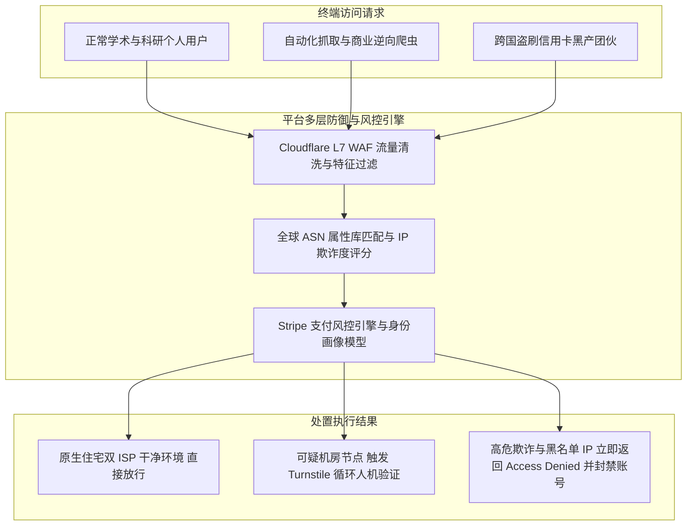
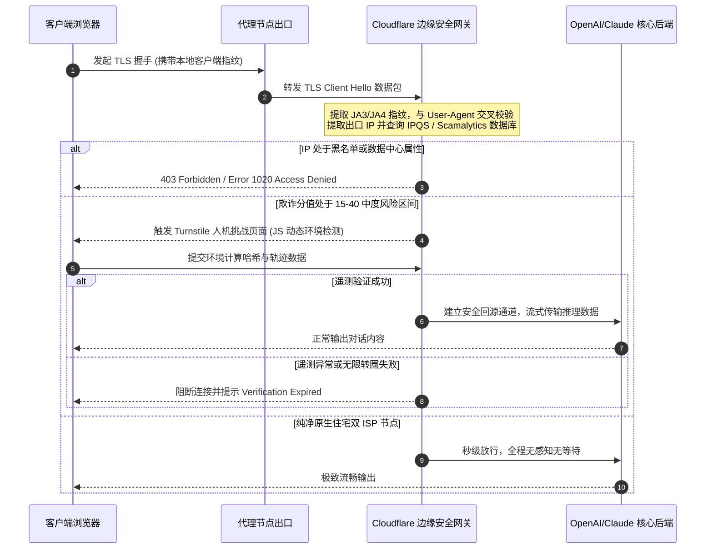
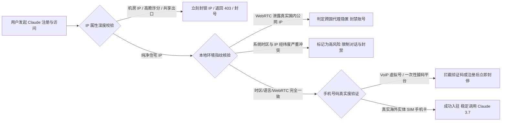
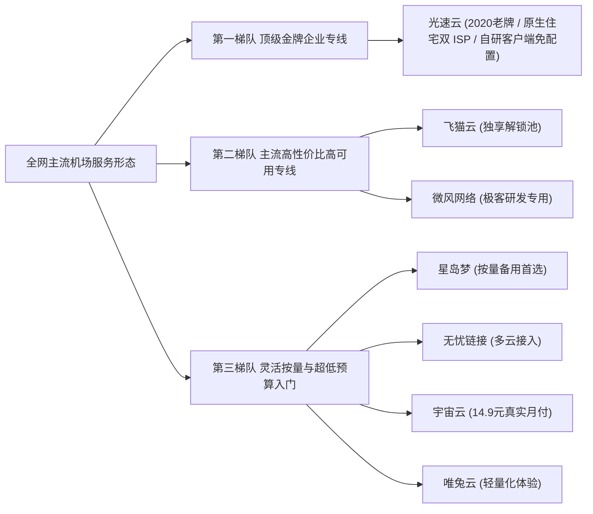
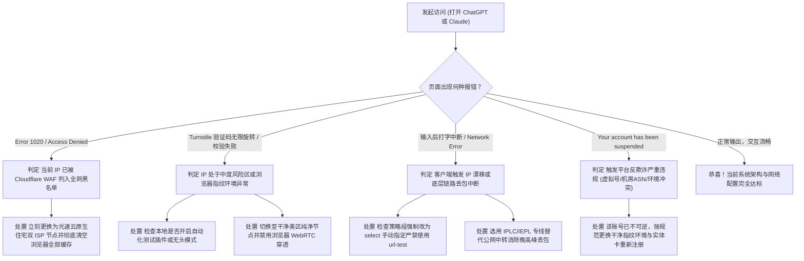

# ChatGPT 与 Claude 原生解锁深度指南 如何避免 Access Denied

日常使用 ChatGPT、Claude 或开发调用其 API 接口时，几乎所有人都遭遇过令人沮丧的异常状态。浏览器界面突然弹出的 Access Denied 报错、无法通过的 Cloudflare 质询循环、生成文本中途频繁出现的 Network Error，甚至新注册的 Claude 账号直接显示已被停用。许多人误以为这仅仅是因为节点速度不够快，或者随意更换几个节点就能永久解决，这种判断往往会导致更为严重的人工智能账号连锁封禁。

OpenAI 与 Anthropic 在其服务入口部署了当今互联网极其严密的自动化风控网络。这套体系融合了第七层应用防护、全球自治系统网络数据库、实时欺诈分值评估系统、浏览器环境指纹追踪以及连接一致性校验。如果用户使用的节点属于廉价数据中心广播 IP，或者网络客户端在不同地域节点之间频繁跳跃漂移，就会在微秒级时间内被安全网关判定为高危流量并予以拦截阻断。

本文从网络底层工程与平台风控算法出发，全面拆解导致访问受阻的底层技术机理。通过对比数据中心机房网络与原生住宅双 ISP 宽带的根本差异，揭示 Claude 严苛封号策略背后的判定维度，并提供生产级防漂移分流配置规则、命令行深度排障检测指令以及真实排障案例，帮助你在 2026 年彻底摆脱风控困扰，建立长期稳定的 AI 访问通道。

---

## 一、为什么 ChatGPT 与 Claude 会对节点严防死守 商业与算力风控模型剖析

要彻底解决连接受阻的问题，必须先站在人工智能平台技术运营的视角，理解他们为何要投入巨额研发资金去拦截代理访问。



### 1. 国际法律合规与服务地域限制的强制要求

OpenAI 与 Anthropic 作为注册并运营在美国的头部人工智能企业，受到极其严格的数据合规、出口管制与版权法约束。

两个平台的服务协议中明确划定了支持国家与地区的白名单。由于特定地区的司法管辖差异与法律合规风险，平台必须确保自身服务不会被来自限制区域的网络直接触达。香港、澳门以及部分未获得官方服务准入的国家和地区，其本地互联网运营商分配的 IP 地址段在平台网关防火墙中被设置为了全网段阻断策略。只要用户的出口 IP 被解析归属于这些限制区域，网关就会在建立 TLS 连接前直接切断传输，并返回区域不可用的提示信息。

### 2. 昂贵的 GPU 推理算力与灰产逆向脚本防御

大语言模型的推理过程需要消耗昂贵的云端 GPU 计算集群资源。每次用户的提问与流式文本输出，都在产生真实的电费与硬件折旧成本。

互联网上存在大量利用未经授权脚本批量调用 Web 界面接口的黑产团队。这些团队试图通过模拟浏览器或逆向工程，将网页端免费额度封装成低价商业 API 倒卖套利。由于此类自动化逆向脚本绝大多数托管在廉价的数据中心虚拟私有服务器中，平台安全团队通过阻断数据中心 IP 网段，能够以极低的管理成本过滤掉超过百分之九十的恶意爬虫请求，从而保护服务器算力资源不被无休止地恶意耗尽。

### 3. 跨国信用卡欺诈防范与 Stripe 支付风控联动

在订阅 ChatGPT Plus、Team 以及 Claude Pro 等高级付费增值服务时，风控引擎的敏感度会提升至最高级别。

平台普遍采用 Stripe 作为底层支付处理基础设施。当用户提交跨国信用卡绑定时，Stripe 的防欺诈算法 Radar 会在后台对用户当前的网络连接特征进行全方位交叉比对。系统会校验当前出口 IP 归属地、DNS 解析来源地、发卡银行所在国家、账单填报地址以及浏览器上报的时区与语言是否完全一致。如果发现用户使用着位于德国机房的数据中心代理，却尝试绑定一张美国发行的个人借记卡，系统就会认定该操作存在盗刷洗钱嫌疑，立刻拒绝扣款并连带将用户的人工智能账号列入冻结名单。

---

## 二、深度拆解 Cloudflare Turnstile 与 L7 WAF 的多维拦截机理

当你在浏览器中看到 Access Denied、Error 1020 或者永无休止的验证码转圈时，真正的拦截源头通常停留在最前沿的 Cloudflare 边缘安全防护网络，尚未触达人工智能模型后端的业务服务器。

### 1. Cloudflare WAF Error 1020 与 403 Forbidden 判定逻辑

Cloudflare 拥有全球极其庞大的边缘节点网络，充当着 OpenAI 与 Anthropic 的第一道防护城墙。

当一个 HTTP 请求到达 Cloudflare 边缘服务器时，第七层应用网关（Layer 7 WAF）会率先读取入站数据包的元数据。系统会提取访问者的源 IP 地址，并在一组由平台安全团队自定义的防护规则集（Firewall Rules）中进行高速匹配。

如果在防护规则中设定了阻断所有被标为数据中心属性的 IP，或者源 IP 出现在了平台内部的恶意流量信誉黑名单中，边缘服务器就会直接生成标准的 403 Forbidden 响应，并在页面中呈现醒目的 Error 1020 Access Denied 报错。这个决策过程完全在边缘计算节点内完成，根本不会将流量回源至后端的业务集群，从而阻断任何潜在风险对内网服务的冲击。

### 2. Turnstile 无感人机验证与交互质询机制

为了在防御机器人的同时尽量保证正常用户的体验，平台广泛启用了 Cloudflare Turnstile 验证技术。

与传统需要用户点击图片、识别扭曲文字验证码的验证机制不同，Turnstile 依靠后台静默执行的遥测脚本来综合评估访问者的人机属性。当用户访问网站时，网页会在后台加载一段经过高强度混淆的 JavaScript 代码。该脚本会在毫秒级时间内检测客户端运行环境，收集包括光标移动轨迹的加速度曲线、按键时序间隔、浏览器事件循环机制完整性以及渲染引擎特征等上百项遥测指标。

如果用户的出口 IP 纯净度极高且来自家庭宽带，Turnstile 会在无感状态下毫秒级通过，用户甚至感知不到验证页面的存在。如果 IP 属于信誉欠佳的共享代理池，系统就会弹出一个复选框让用户手动确认。当脚本检测到底层浏览器存在无头模式特征、自动化测试驱动环境或者 IP 处于高风险信誉区间时，复选框就会陷入无限旋转校验失败的死循环，最终拒绝放行。

### 3. TLS 客户端指纹识别与 JA3 与 JA4 特征提取

在网络传输层与应用层之间，存在一项许多普通用户并不知晓的核心鉴别技术，即 TLS 客户端指纹识别。

在建立安全通信隧道时，客户端需要向服务器发送一个 Client Hello 数据包。由于不同操作系统、不同底层网络库（例如 Python 的 requests 库、Go 语言的 http 客户端、Node.js 原生模块）以及不同浏览器版本在支持的密码套件顺序、TLS 扩展协议版本、椭圆曲线算法偏好等方面存在微观排列差异，安全网关会将这些特征拼接后计算出唯一的哈希值，行业内通常称之为 JA3 或最新的 JA4 指纹。



如果一个请求的 HTTP 头部声称自己是最新版本的桌面版 Google Chrome 浏览器，但其提交的 TLS 握手特征却与一段 Python 自动化抓取脚本的 JA3 特征完全吻合，网关就会立刻判定该连接使用了伪造请求头的自动化爬虫工具，无需任何额外人工介入，直接在底层下发阻断策略。

---

## 三、数据中心 IP 与原生住宅双 ISP 的本质差异 为什么普通机房必被封

理解了平台的防御机制后，很多读者会产生一个疑问。为什么自己购买的便宜节点在看 YouTube 4K 视频时速度飞快，但一打开 ChatGPT 或 Claude 就立刻报错。这其中的核心矛盾就在于网络节点的 IP 属性与分配来源。

### 1. 数据中心机房 IP 的天然缺陷与 ASN 数据库打标

全球互联网上的每一个公共 IP 地址，都归属于某个自治系统（Autonomous System，简称 AS），并拥有唯一的自治系统编号（ASN）。

国际互联网注册机构（如亚太地区的 APNIC、美洲地区的 ARIN 等）对所有的 ASN 拥有明确的登记用途划分。诸如亚马逊 AWS、微软 Azure、谷歌云 GCP、DigitalOcean、Linode、搬瓦工、Oracle 等公有云和机房托管服务商，其持有的 IP 网段在国际权威数据库（如 MaxMind、IPinfo、DB-IP）中，其网络类型字段被统一永久性标记为 Hosting 或 Data Center。

商业人工智能平台每天都会自动同步这些全球数据库的最新网段变更。对于这类机房 IP，平台安全策略的默认基调就是高危与不受信任。在日常的大规模封控周期中，安全团队只需要在防火墙后台勾选一键屏蔽特定机房 ASN，成千上万挂载在这些服务器上的代理节点就会在一瞬间全军覆没。

### 2. 广播 IP 与原生物理 IP 的技术边界

在代理网络市场中，商家经常提及广播 IP 与原生物理 IP 的概念，这涉及到跨国路由与 IP 播发的技术细节。

广播 IP 通常指机房运营方通过边界网关协议（BGP），将原本注册在某个国家或地区的 IP 段，宣告并映射到另一处地理位置的服务器上。例如某些服务商将美国注册的廉价 IP 网段广播至香港机房使用。这种 IP 在部分粗糙的地理位置库中可能显示为目标国家，但在更深层的路由跳数探测（Traceroute）与物理时延比对下会原形毕露。由于跨国广播 IP 在多方数据库中的地理信息、注册商组织信息与实际物理出口高度脱节，这类 IP 的信誉权重在严苛的风控体系中会遭到严重降权扣分。

原生 IP 则要求该 IP 地址的注册分配地、物理机房所在网络以及运营商登记归属完全一致，路由路径干净平直，不存在跨区域偷换宣告的异常情况。

### 3. 什么是原生双 ISP 住宅宽带及其纯净度指标

原生双 ISP 住宅宽带，是目前应对各类人工智能平台与海外流媒体风控最为稳健的网络形态。

所谓双 ISP，是指在权威 IP 数据库中进行深度穿透查询时，该 IP 地址对应的两个核心属性字段，即网络服务提供商（ISP）与自治系统组织（ASN Organization），全部被正式登记为海外本地正规民用宽带电信运营商的名称，例如美国的 AT&T、Verizon、Comcast、Spectrum，日本的 NTT、KDDI、SoftBank，香港的 HKT 电讯盈科等，绝不包含任何诸如 Hosting、Data Center、Cloud、Server 等机房字样。

住宅原生 IP 属于海外千万普通家庭用户日常上网所分配的真实民用宽带资源。OpenAI 和 Anthropic 不可能将民用宽带运营商的真实住宅 IP 段整体列入黑名单，否则将导致数以千万计的海外真实本土用户无法正常使用其官方产品。因此，具备双 ISP 属性且历史滥用记录极低的出口节点，在通过安全网关时拥有最高信任评级。

### 4. Scamalytics 与 IPQualityScore 欺诈分值的计算原理

在网络风控工业界，Scamalytics 和 IPQualityScore（IPQS）是两家被各大企业广泛采购的第三方欺诈评估服务商。

这两家服务商维护着庞大的黑灰产监测蜜罐网络。它们实时监控全球每一个 IP 地址上的代理扫描活动、钓鱼邮件发送频次、暴力破解记录、匿名代理挂载情况以及网络攻击行为，并综合计算出一个介于 0 到 100 之间的动态欺诈分值（Fraud Score）。

分值越低，代表该 IP 越纯净安全。如果一个 IP 的评分在 0 到 10 之间，网关会视为无风险直接放行。如果评分攀升至 15 到 30 之间，就会频繁触发 Turnstile 人机验证质询。一旦评分突破 40 甚至达到 80 以上，就会被安全系统判定为高危恶意节点，触发即时拦截阻断。绝大多数普通机场为了削减带宽成本，采购的廉价机房 IP 往往由于成百上千人共用且频繁用于自动化抓取，其欺诈分值长期处于 50 到 90 的高危危险区间。

| 评估维度 | 数据中心机房 IP (Hosting) | 跨境 BGP 广播 IP | 普通单 ISP 住宅 IP | 原生双 ISP 企业级住宅专线 |
| :--- | :--- | :--- | :--- | :--- |
| **IP 归属类型** | Data Center / Cloud | 混杂 / 广播映射 | 居民宽带 (Residential) | 纯正民用宽带 (Residential) |
| **ASN 组织属性** | 机房服务商 (如 AWS/OVH) | 商业云租借主体 | 基础电信商 / 转租云 | 本地一级电信运营商 (如 AT&T) |
| **Scamalytics 欺诈分** | 45 到 95 (极高风险) | 30 到 70 (中高风险) | 10 到 25 (低风险) | 0 到 5 (极度纯净) |
| **Turnstile 验证率** | 频繁弹出甚至无限循环 | 较大概率触发手动点击 | 极低概率触发 | 全程无感毫秒级静默通过 |
| **ChatGPT 4o 连通率** | 频繁报错 1020 或 Access Denied | 偶尔可用但偶发网络中断 | 稳定可用 | 长期极度稳定，秒级响应 |
| **Claude 3.7 存活率** | 极易秒封账号或阻断注册 | 存活周期极短，随时失效 | 能够稳定对话 | 注册与长文本推理极高存活率 |
| **典型代表服务** | 廉价公共中转节点 / 自建 VPS | 廉价拼车机场公网出口 | 动态住宅代理池 | 光速云等顶级企业专线 AI 专用节点 |

---

## 四、Anthropic 与 Claude 的极端风控机制 为什么比 ChatGPT 更容易封号

在目前的主流 AI 工具中，使用 Claude 的用户群体普遍感受到其风控策略比 ChatGPT 更加激进和苛刻。许多用户刚完成邮箱验证，甚至还没来得及输入第一句提示词，账号界面就直接弹出了红色横幅，提示你的账号已被停用（Your account has been suspended）。造成这一现象的原因，源于 Anthropic 独特的安全模型与多维度端点审查机制。



### 1. Anthropic 对 IP 欺诈度与 ASN 的严苛过滤

Anthropic 从成立之初就将系统安全性置于最高优先级。其团队内部部署的滥用检测系统对出入流量的纯净度有着近乎偏执的要求。

不同于 ChatGPT 经常只是根据 IP 风险限制游客模式或者偶尔要求刷新人机验证，Anthropic 倾向于采用直接阻断与连带封号的惩罚机制。一旦发现某个 IP 地址在短时间内发起了多个会话请求，或者该 IP 对应的 ASN 存在不良信誉历史，系统不仅会立刻阻断当前的 WebSocket 数据流传输，更会将当前已登录的账号直接打上异常标签并列入吊销执行队列。

如果多个用户在同一家机场的同一台代理服务器上同时使用 Claude，只要其中一人在对话中触发了敏感安全违规或者运行了批量自动化抓取脚本，整台代理服务器的出口 IP 就会被全网拉黑，连带导致该 IP 上所有的其他登录用户在几分钟内集体遭遇封号连坐。

### 2. 浏览器环境指纹追踪与本地真实环境泄露

仅仅出口 IP 干净，并不能保证在 Claude 面前万无一失。Anthropic 的前端页面在用户载入时，会深度读取浏览器环境中的各项软硬件特征并进行一致性交叉审计。

其中最为致命的泄露途径是 WebRTC（网页实时通信）穿透泄露。WebRTC 协议为了实现点对点低时延语音或视频传输，会绕过大部分简易代理扩展，直接向网络底层请求系统的所有本地及公网 IP 地址。如果用户虽然开启了全局代理，但客户端未能正确拦截或屏蔽 WebRTC 探测，浏览器就会直接将用户国内宽带的真实公网 IP 上报给页面。网关在收到请求时，发现 HTTP 请求头来自美国，而 WebRTC 汇报的真实地址来自国内，这种明显的跨国穿透行为会立刻触发平台的自动封禁判定。

浏览器配置的系统时区（Timezone）、系统主语言（Accept-Language）以及地理定位信息，如果与当前代理 IP 的经纬度存在剧烈偏差，例如 IP 位于美国洛杉矶，而系统时区却显示为东八区北京时间，且系统语言为纯简体中文无任何英文辅助语言环境，这种明显的特征冲突同样会被风控系统作为高可信度的环境欺诈证据记录在案。

### 3. 手机号码风控与虚拟号黑名单拦截

在注册账号环节，手机号码的性质同样是一道难以逾越的技术鸿沟。

海外电信市场存在大量的网络虚拟电话服务，例如 Google Voice、TextNow 以及各大公开的接码平台短信临时接收卡。这类号码被电信系统定义为 VoIP（基于 IP 的语音传输服务）。Anthropic 的短信下发网关与各大国际运营商数据库实时打通，能够瞬间识破号码的底层属性。一旦识别出注册手机号为虚拟 VoIP 号码，系统会直接报错拒绝发送验证码。即使用户通过某些灰色接码渠道强行完成了注册，这些公用接码平台的号码往往早已被数千名滥用者重复使用过，系统风控脚本在后续复核时，会因号码关联度过高而将账号批量封杀。

---

## 五、客户端分流配置实战 杜绝 IP 漂移导致的风控封禁

在实际排障排查中，许多自认为购买了高质量专线节点的用户依然遭遇了封号。经过深入分析其客户端配置日志，深入分析其客户端配置日志可以发现，绝大多数故障直接源于客户端错误的路由分流策略导致的 IP 漂移，与节点本身网络物理链路往往没有直接关联。

### 1. 什么是 IP 漂移以及为何自动选路是账号杀手

在主流代理工具（如 Clash Verge Rev、Mihomo Party、Sing-box 等）中，为了追求连接速度，许多新手喜欢将代理组策略类型设置为 `url-test`（自动测速选择最低延迟节点）或者 `load-balance`（负载均衡负载分担）。

这种配置在浏览普通网页时体验良好，但在使用 AI 工具时却是致命的安全隐患。人工智能平台的长文本生成和上下文记忆，极度依赖于持续保持稳定的双向长连接（WebSocket 与 Server-Sent Events 流式传输）。

当你在向 Claude 或 ChatGPT 提交一个复杂的长文本提示词时，客户端在后台默默执行定时测速。如果原先连接的美国节点由于海底光缆抖动延迟增加了二十毫秒，客户端策略组就会在一瞬间将后续传输无缝切换到另一个位于日本或新加坡的节点上。在平台风控系统看来，同一个用户前一秒还在洛杉矶发起提问，下一秒就跨越了上万公里在东京接收回复，这种违背物理规律的瞬间地理跨越行为，会被反欺诈系统无条件判定为账号凭据遭黑客窃取并在异地遭到并发盗用，从而直接触发紧急停机与永久封停。

### 2. 生产级 Mihomo 与 Clash 科学分流配置规范

要彻底杜绝 IP 漂移，必须在分流配置文件中为人工智能平台设立完全独立的专用策略组，并且该策略组的类型必须强制声明为手动选择模式（`type: select`），严禁嵌套任何自动优选规则。

以下是一份经过严格工程验证的 Mihomo / Clash Meta 生产级核心配置片段。该配置精确规范了 OpenAI、Anthropic、Claude、Stripe 以及主流 AI 编程助手的网络走向，确保流量始终牢牢锚定在单一的高品质原生双 ISP 节点上，从根源上消除 IP 乱跳带来的连带风控。

```yaml
# ==============================================================================
# 生产级 AI 专用防漂移高可靠分流配置片段
# 适用于 Clash Meta / Mihomo 核心内核
# ==============================================================================

proxy-groups:
  # 1. 顶层主出口代理组 (日常通用浏览)
  - name: 🚀 默认代理出口
    type: select
    proxies:
      - 🇭🇰 香港 IEPL 专线 [原生双ISP]
      - 🇯🇵 日本 IEPL 专线 [原生双ISP]
      - 🇺🇸 美国 IPLC 专线 [原生住宅双ISP]
      - 🇸🇬 新加坡 IEPL 专线 [低延迟]

  # 2. 核心 AI 专属策略组 (强制指定手动固定模式，绝对严禁使用 url-test 或 load-balance)
  - name: 🤖 人工智能服务 (OpenAI/Claude)
    type: select
    proxies:
      - 🇺🇸 美国 IPLC 专线 [原生住宅双ISP] # 极力推荐主选 纯净住宅出口，风控全绿
      - 🇯🇵 日本 IEPL 专线 [原生双ISP]     # 高清备选 亚太原生出口
      - DIRECT                          # 故障应急兜底直连

  # 3. 跨境金融与支付专用策略组 (确保充值续费与绑卡环节 IP 绝对固定)
  - name: 💳 跨境支付与订阅 (Stripe/Paypal)
    type: select
    proxies:
      - 🇺🇸 美国 IPLC 专线 [原生住宅双ISP] # 必须与 AI 策略组保持同一节点，避免绑卡触发风控

# 规则匹配引擎 (严格自上而下匹配，最具体的规则置于前列)
rules:
  # ----------------------------------------------------------------------------
  # Anthropic 与 Claude 核心生态域名集合
  # ----------------------------------------------------------------------------
  - DOMAIN-SUFFIX,claude.ai,🤖 人工智能服务 (OpenAI/Claude)
  - DOMAIN-SUFFIX,anthropic.com,🤖 人工智能服务 (OpenAI/Claude)
  - DOMAIN,cdn.usefathom.com,🤖 人工智能服务 (OpenAI/Claude)
  - DOMAIN-KEYWORD,anthropic,🤖 人工智能服务 (OpenAI/Claude)
  - DOMAIN-KEYWORD,claude,🤖 人工智能服务 (OpenAI/Claude)

  # ----------------------------------------------------------------------------
  # OpenAI 与 ChatGPT 核心生态域名集合
  # ----------------------------------------------------------------------------
  - DOMAIN-SUFFIX,chatgpt.com,🤖 人工智能服务 (OpenAI/Claude)
  - DOMAIN-SUFFIX,oaistatic.com,🤖 人工智能服务 (OpenAI/Claude)
  - DOMAIN-SUFFIX,oaiusercontent.com,🤖 人工智能服务 (OpenAI/Claude)
  - DOMAIN-SUFFIX,openai.com,🤖 人工智能服务 (OpenAI/Claude)
  - DOMAIN-SUFFIX,sentry.io,🤖 人工智能服务 (OpenAI/Claude)
  - DOMAIN-KEYWORD,openai,🤖 人工智能服务 (OpenAI/Claude)

  # ----------------------------------------------------------------------------
  # AI 开发者生态 (Cursor, GitHub Copilot, Perplexity 等)
  # ----------------------------------------------------------------------------
  - DOMAIN-SUFFIX,cursor.sh,🤖 人工智能服务 (OpenAI/Claude)
  - DOMAIN-SUFFIX,cursor.com,🤖 人工智能服务 (OpenAI/Claude)
  - DOMAIN-SUFFIX,perplexity.ai,🤖 人工智能服务 (OpenAI/Claude)

  # ----------------------------------------------------------------------------
  # 跨境支付与防欺诈网关域名 (绑定信用卡与升级订阅专用)
  # ----------------------------------------------------------------------------
  - DOMAIN-SUFFIX,stripe.com,💳 跨境支付与订阅 (Stripe/Paypal)
  - DOMAIN-SUFFIX,stripe.network,💳 跨境支付与订阅 (Stripe/Paypal)

  # 基础流量走向
  - GEOIP,CN,DIRECT
  - MATCH,🚀 默认代理出口
```

### 3. DNS 防泄漏与 EDNS 客户端子网隐私加固

除了网络层面的分流之外，域名解析系统（DNS）的配置错误同样会导致前功尽弃。

许多用户在客户端中配置了国内公共 DNS 作为解析源。当浏览器尝试解析 `chatgpt.com` 时，客户端首先向国内 DNS 服务器发起查询。此时不仅请求可能遭遇运营商级别的 DNS 劫持污染，更严重的是，部分支持 EDNS 客户端子网（ECS）特性的 DNS 服务器，会将你位于国内的真实 IP 网段作为辅助信息携带并上报给海外权威根域名服务器。OpenAI 的智能解析系统据此感知到解析请求来自于中国大陆境内，进而在建立连接之前提前准备好拒绝响应。

解决该问题的标准做法是在客户端开启 Fake-IP 模式，并将远程国外域名的解析服务器强制指定为经过 TLS 加密的海外原生纯净 DoH 节点（例如 Cloudflare 的 `https://1.1.1.1/dns-query` 或 Google 的 `https://8.8.8.8/dns-query`），同时在配置中明确关闭 `send-client-ip` 选项，彻底切断 DNS 链路上的溯源信息暴露。

---

## 六、终端网络与环境检测实战 命令行自检与排障指令

在日常排查网络连通性时，仅凭浏览器的界面报错往往难以定位深层原因。熟练使用终端命令行工具直接与服务端交互，能够快速捕获第一手响应状态码与网络握手详情。

### 1. Linux 与 macOS Bash 终端一键检测脚本

在类 Unix 系统的终端中，我们可以借助强大的 `curl` 命令，通过挂载本地代理端口对当前出口节点进行全面体检。

执行以下指令，快速查询当前出口节点的物理 IP、归属地理位置、ASN 编号以及电信组织类型。

```bash
# 1. 穿透代理检测当前公网出口的 IP 属性与运营商归属
curl -s -x socks5h://127.0.0.1:7890 https://ipinfo.io/json | jq .

# 预期正常回显输出分析
# {
#   "ip": "162.247.74.88",
#   "city": "Los Angeles",
#   "region": "California",
#   "country": "US",
#   "loc": "34.0522,-118.2437",
#   "org": "AS7018 AT&T Services, Inc.",  <-- 核心验证点 属于 AT&T 民用宽带，无 Hosting 字样
#   "postal": "90001",
#   "timezone": "America/Los_Angeles"
# }

# 2. 测试对 OpenAI 首页的连通性与 HTTP 状态码回执
curl -I -s --connect-timeout 5 -x http://127.0.0.1:7890 https://chatgpt.com | grep -E "HTTP|cf-ray"

# 预期正常放行回执
# HTTP/2 200 (或 307 重定向至登录页，代表已成功穿透，无 403 拦截)
# cf-ray: 8c34f71a9b2c8901-LAX

# 3. 测试对 Claude 平台的连通性与底层防护响应
curl -I -s --connect-timeout 5 -x http://127.0.0.1:7890 https://claude.ai | grep -E "HTTP|cf-ray"

# 正常回执应为 HTTP/2 200，若出现 HTTP/2 403 则表明该节点已被 Anthropic 明确拉黑
```

### 2. Windows PowerShell 诊断与故障回执分析

在 Windows 操作系统下，用户可以直接打开 PowerShell 控制台，利用内置的 Web 请求命令验证代理隧道的畅通程度。

```powershell
# 1. 设置会话级别的本地代理环境变量 (假设本地客户端监听端口为 7890)
$env:HTTP_PROXY="http://127.0.0.1:7890"
$env:HTTPS_PROXY="http://127.0.0.1:7890"

# 2. 发起 API 请求检验当前节点对外部呈现的真实公网 IP
$Response = Invoke-RestMethod -Uri "https://api.myip.la/cn?json"
Write-Host "当前代理出口 IP 为: $($Response.ip)"
Write-Host "地理归属位置为: $($Response.location.city), $($Response.location.country_name)"

# 3. 探测 Cloudflare 基础网关阻断状态
try {
    $Check = Invoke-WebRequest -Uri "https://chatgpt.com" -Method Head -TimeoutSec 5
    Write-Host "ChatGPT 网关连接正常，返回状态码: $($Check.StatusCode)" -ForegroundColor Green
} catch {
    Write-Host "连接遭遇异常阻断: $($_.Exception.Message)" -ForegroundColor Red
}
```

### 3. 常见 HTTP 异常状态码背后的核心技术诱因

通过命令行获取到 HTTP 状态码后，可以对照以下诊断标准快速明确定位问题根源。

遇到 HTTP 403 Forbidden 且响应头部包含 `cf-mitigated: challenge` 字段时，意味着 Cloudflare 正在下发 Turnstile 人机挑战，当前 IP 信誉度偏低但尚未被永久处死。如果返回标准的 `403 Forbidden` 且页面内容为 `Access Denied (Error code 1020)`，说明当前节点已被平台安全团队全局拉黑，必须立即更换节点出口。如果收到 HTTP 429 Too Many Requests，通常表示当前节点所在网段存在大量并发请求耗尽了速率配额，或者该 IP 正在被其他用户共用滥用。

---

## 七、真实排障与账号解封实战案例复盘

为了让读者更深刻地掌握实际操作中的排障细节，以下整理记录了三个极具代表性的真实运维与个人排障案例。

### 案例一 香港及常见机房节点触发 Cloudflare 1020 Access Denied 报错排查与解决

#### 1. 故障发生场景与现场环境

某跨国跨境电商团队的多名运营人员在日常办公时，发现浏览器打开 `chatgpt.com` 页面时，无法进入任何输入界面，全员统一弹出 Cloudflare 的深灰色报错窗口。页面中央显示红色叉号，明确提示 Access Denied，下方标注错误代码 Error 1020。

团队当时使用的网络环境为某知名大型机场的香港中继普通节点，客户端为 Windows 环境下的 Clash Verge，分流模式勾选为全局代理模式。

#### 2. 底层抓包分析与关键证据排查

技术支持人员介入后，首先在终端中使用 `curl` 针对目标域名发起了原始数据包探测。

探测结果显示，该香港节点的出口 IP 属于某著名国际服务器租用商的机房数据中心网段（ASN 类型明确标记为 Hosting）。进一步针对 OpenAI 登录校验端点发送模拟握手请求，服务器立刻返回了 `CF-Chl-Bypass: 0` 以及 `HTTP/2 403`。

排障人员打开 Scamalytics 官方查询接口，将该出口 IP 录入比对。系统报告显示该 IP 的欺诈评分高达 82 分，过去二十四小时内存在数百次针对公网其他服务器端口的异常扫描行为，其 IP 信誉已被各大网络安全中心评定为极度恶劣。

#### 3. 执行方案与修复验证

技术人员指导团队立刻停用当前的香港机房节点。在客户端策略组中，将 AI 专用分流组重新绑定为光速云提供的美国原生住宅双 ISP 专线节点。

切换节点后，技术人员要求运营人员在浏览器中按下 `Ctrl + Shift + Delete`，彻底清除与 `chatgpt.com` 以及 `openai.com` 相关的所有本地缓存 Cookie、Service Workers 与本地存储数据库，以防止此前残留的风控跟踪标记继续影响判定。在完成了浏览器数据清理并重启客户端后，用户再次访问页面，Cloudflare 盾牌页面仅闪烁了不到零点一秒即无感通过，系统秒级顺利跳转进入对话界面，提问与长文本生成功能完全恢复正常。

### 案例二 Claude 3.7 账号刚注册即提示 Your account has been suspended 深度复盘

#### 1. 故障发生场景与现场环境

某高校科研人员为了测试 Claude 3.7 的深度代码推理能力，在个人电脑上使用全新的微软 Outlook 邮箱进行了账号注册。在通过了公开免费接码平台提供的虚拟短信验证码后，页面顺利加载出了个人信息填报表单。但在点击最后一步提交按钮后，页面突然闪退并强行登出，再次尝试登录时，屏幕直接弹出了醒目的红色警告条，内容为 Your account has been suspended，提示该账户因违反服务条款已被永久封停。

#### 2. 底层抓包分析与关键证据排查

技术人员在复盘其注册全流程操作时，发现当事人犯下了多项严重的叠加性风控违规。

第一，其所使用的节点属于自建的廉价 VPS 服务器，该服务器位于德国法兰克福的一家通用云机房中，ASN 数据库明确显示其类型为数据中心托管，信誉评级极低。

第二，经测试其浏览器的 WebRTC 处于默认未屏蔽状态。页面加载过程中，通过内部 STUN 服务器探测，浏览器直接向 Anthropic 前端服务器汇报了其位于国内电信宽带的真实公网 IP。

第三，当事人所填报的短信验证码来自于公开接码平台的虚拟号码。数据库记录显示该号码在过去一周内曾被多个恶意抓取机器人尝试用于批量注册，早已被 Anthropic 列入严厉惩戒黑名单。

#### 3. 执行方案与修复验证

技术人员协助当事人重构了干净无污染的整套运行环境。

第一步，在网络出口端，全面迁移至具备双 ISP 属性且 Scamalytics 欺诈分为 0 的优质美区原生企业专线，彻底消除机房标记。

第二步，在当事人的 Chrome 浏览器中安装并启用了 WebRTC Control 扩展程序，将 WebRTC 隐私策略设置为完全禁用模式，封堵真实 IP 穿透通道。同时在 Windows 系统设置中，将本地操作系统时区调整为太平洋标准时间（UTC-8 洛杉矶），并将操作系统的首选显示语言调整为美式英语（en-US）。

第三步，重新启用一个独立的专业 ProtonMail 邮箱，并借用海外亲友持有的真实 T-Mobile 实体手机 SIM 卡重新接收短信验证。在全新的干净环境加持下，新账号顺利完成注册，后续连续进行高强度复杂长代码分析推理长达数月，再未发生过任何异常告警或二次人机校验。

### 案例三 开启 url-test 自动选路导致 ChatGPT 频繁报 Network Error 与会话中断

#### 1. 故障发生场景与现场环境

某软件工程师在日常使用 Cursor 搭配网页端 ChatGPT 4o 辅助编写后端项目时，频繁遭遇令人烦躁的体验问题。每次让模型生成一段超过两百行的复杂代码时，文本打字机效果输出到一半就会突然卡死中断，控制台界面随后弹出鲜红色的提示框，报错信息为 Network Error 或者是 Conversation not found。

#### 2. 底层抓包分析与关键证据排查

排障人员调取了该工程师本地 Mihomo 内核的详细连接日志（Connection Log）。

通过对时间轴进行微观比对，排障人员发现了问题的致命根源。该工程师为了贪图方便，在配置文件中将针对所有境外域名的分流规则统一指向了一个名为 `AUTO-SPEED` 的策略组，该策略组的参数被设置为了 `type: url-test, interval: 180, tolerance: 20`。

这意味着内核每隔三分钟就会向指定的测速服务器发起一次延迟探测，只要另一条节点的延迟比当前节点低二十毫秒以上，内核就会立刻无情地把后续连接导向新节点。日志清晰记录显示，在工程师发起长文本提问的第一分钟，会话建立在洛杉矶节点上；两分钟后由于国际光缆微小的毫秒级抖动，内核自动将路由切换至了东京节点。OpenAI 的长连接安全机制在检测到客户端 IP 突变且会话上下文凭据不匹配后，出于安全审计考虑主动掐断了原有的数据流，进而导致网页端直接报出网络通信故障。

#### 3. 执行方案与修复验证

工程师在技术人员指导下修改了本地配置文件，将所有与 `chatgpt.com`、`openai.com` 以及 `cursor.sh` 相关的规则完全剥离出来，绑定至独立的 `AI-Static-Group` 策略组中，并将其类型严格锁死为 `type: select`，固定手动锚定在美国原生专线节点上。

完成配置重载后，再次让模型生成长达上千行的庞大系统工程代码，整个流式传输过程犹如行云流水，文本输出持续平稳不间断，彻底终结了中途卡死报错的顽疾。

---

## 八、AI 专用优质专线与原生节点梯度推荐

在解决完客户端分流与操作环境后，底层网络物理质量是决定体验上限的最坚固基石。为了帮助广大读者在选购网络服务时避开虚假宣传的陷阱，以下梳理列出经过严苛实测检验的机场服务梯队。



### 1. 光速云 全场景 AI 解锁与企业级专线首选

光速云自 2020 年成立以来，始终保持着极高水准的运维品质，在资深极客与专业外贸开发者群体中建立了卓越的口碑，是目前应对 ChatGPT 4o、Claude 3.7 以及各类 AI 编程助手当之无愧的综合排名第一服务商。

在物理基础设施层面，光速云重金采购了真正的企业级 IEPL 与 IPLC 物理内网专线，涵盖深港与沪日核心干线，全网主干带宽冗余高达 2.5Gbps。这使得其网络完全脱离了公网国际出口防火墙的深度审查与 QoS 丢包压制，即使在晚间八点到十一点的全球网络晚高峰时段，依然能够保持零丢包与极度平稳的低延迟。

针对日益严苛的人工智能风控，光速云为其主力节点全量配置了海外当地一级民用电信运营商的原生住宅双 ISP 物理出口，Scamalytics 欺诈评级长期保持在 0 到 3 分的极低危险区间。无论是注册高难度的 Claude 账号，还是绑定海外商业信用卡开通高级订阅，都能获得极高的通过率。

光速云还推出了独家自研的多平台客户端，内部深度预置了防 IP 漂移与 AI 专属分流策略，新手用户下载登录后无需任何复杂的参数调试即可直接享受完美的解锁体验。其官方推出的限时八折特惠码 `AMM` 更是大幅降低了长期稳定使用的门槛。

### 2. 飞猫云 独享资源池与大流量高性价比梯队

飞猫云在亚太跨境网络市场深耕多年，其核心亮点在于拥有规模庞大的海外原生流媒体与 AI 解锁资源池。

其节点在应对 OpenAI 与 Netflix 等常规平台的高并发访问时表现出众，网络架构具备良好的动态弹性扩容能力。对于日常需要高频进行多模态视频生成、大文件数据互传的用户而言，飞猫云能够在兼顾解锁稳定性的同时，提供极为充沛的月度流量包与出色的带宽性价比。

### 3. 微风网络 追求极致稳定的硬核极客优选

微风网络在架构设计上极具工程师极客基因，其主打全节点高规格专线冗余互备。

微风网络的管理团队对节点负载率有着近乎苛刻的物理上限控制，严厉杜绝超卖抢占带宽的现象。其节点在各大技术论坛的测速评比中常年保持着极低的抖动方差，对于依赖 API 接口进行高并发自动化开发、调用 Claude 编写企业级系统架构的开发团队而言，微风网络能够提供犹如本地局域网一般稳定靠谱的长连接保障。

### 4. 星岛梦 零门槛按量计费不限时备用神机

星岛梦的定位非常明确且实用，其主打永久不限时的纯按量计费计费模型。

很多用户日常对人工智能的使用频次呈现脉冲式分布，可能连续两周不需要大量使用，随后几天又需要集中调用。传统月付套餐在这种场景下容易造成资源浪费。星岛梦购买一次流量额度即可长期有效使用，非常适合作为个人主力专线之外的应急备用网络，当主节点遭遇突发性运营商割接维护时，能够瞬间无缝顶上。

### 5. 无忧链接 多云 BGP 接入与高兼容性

无忧链接依托全国多个核心城市的多线 BGP 汇聚入口，具备极其强大的内网三网兼容能力。无论用户本地使用的是中国电信、中国联通还是中国移动宽带，都能在接入端智能匹配到延迟最低的机房入口，有效改善了部分偏远省份宽带连接海外延迟过高的问题。

### 6. 宇宙云 真实月付 14.9 元的超高性价比破局者

宇宙云在百元级预算市场拥有极具竞争力的定价优势。其推出的真实月付 14.9 元入门级套餐，彻底打破了行业内要求一次性年付的高门槛行规。对于预算有限的在校大学生群体、偶尔需要查阅海外学术文献或尝鲜体验人工智能对话的轻度用户，宇宙云提供了极具诚意的入门选项。

### 7. 唯兔云 场景针对性优化的敏捷网络

唯兔云专注于特定细分场景的加速优化，其节点针对各类移动端办公客户端进行了轻量化握手调优，连接建立迅速，能够满足普通用户在移动设备上的基本网络需求。

---

## 九、全场景 AI 访问故障诊断决策树与排查指南

为了帮助读者在遇到网络异常时能够以最短路径排查问题，以下梳理出了标准的故障排查诊断决策树。



遇到突发异常阻断时，请严格遵照以下五步法进行顺序排查。

第一步，检查当前出口 IP 的地理位置与自治系统属性。打开终端运行检测指令，确认出口 IP 确实位于服务允许的国家境内，且自治系统组织明确属于正规民用宽带运营商。

第二步，审查客户端代理策略组设置。打开本地代理软件，确保 AI 专属策略组已经被明确固定在单一的高品质节点上，没有勾选任何自动测速切换选项。

第三步，检查本地浏览器隐私设置。安装 WebRTC 屏蔽插件，确保外部网站无法探测到本机的真实局域网与国内公网 IP 地址。

第四步，保持操作系统环境逻辑自洽。检查本机的系统时间、时区设置以及默认显示语言，确保其与节点所在地理位置的经纬度保持高度一致。

第五步，彻底清理残留指纹。在切换配置后，关闭所有相关标签页，进入浏览器设置彻底清除特定域名的所有 Cookie 和历史离线数据，重新启动浏览器建立全新的清洁会话。

---

## 十、关于 ChatGPT 与 Claude 原生解锁的高频疑难解答

在日常服务广大用户的过程中，技术团队收集汇总了一批最具代表性的高频疑难提问，在此统一给出详尽的专业解答。

### Q1. 为什么明明节点在测速网站显示为美国 IP，打开 ChatGPT 仍然提示 Access Denied？

地理位置仅仅是风控系统检验的最基础维度，绝非唯一维度。

许多用户误以为只要 IP 显示在美国就算合规。但事实上，绝大多数被封锁的美国 IP 属于数据中心机房托管服务器（如 AWS、DigitalOcean、Vultr 等）。虽然这些服务器物理放置在美国境内，但其 ASN 类型被清清楚楚标记为了机房托管。OpenAI 的第一道网关规则就直接拦截了非家庭宽带属性的数据中心流量。如果该 IP 曾经被其他租户用于运行自动化爬虫、发送垃圾邮件或频繁发起暴力探测，其在 Scamalytics 数据库中的欺诈分值会高达数十分。对于这种高风险机房 IP，网关根本不会因为其位于美国而网开一面，直接返回标准的 Access Denied 报错。

### Q2. 为什么使用香港节点可以流畅打开 Google 和 YouTube，却完全无法访问 ChatGPT 和 Claude？

这涉及到不同跨国互联网公司在商业运营与地缘合规层面的巨大战略差异。

Google 和 YouTube 拥有全球性跨国基础设施，在香港拥有庞大的数据中心和直接落地的本地业务网络，其服务本身即完全对香港本地互联网开放并提供本地化内容分发。

OpenAI 与 Anthropic 由于特定司法管辖区的数据合规政策、人工智能出口管制以及本地服务牌照审批等一系列复杂的国际法律限制，至今尚未将中国香港纳入其官方支持服务的白名单区域。两家公司在最外层的防火墙规则中，对所有归属于香港的运营商网段执行了全网段一刀切的物理屏蔽。因此，无论你的香港节点速度有多快，只要出口 IP 归属于香港，在访问这两家平台时就会被立刻拦截。

### Q3. 为什么在订阅 ChatGPT Plus 或 Claude Pro 充值续费时总被系统拒绝甚至连带封号？

高级付费订阅流程涉及到了极其敏感的国际金融支付反洗钱风控，其安全审查严苛程度数十倍于普通的浏览对话。

当用户在结算页面点击确认支付时，后台运行的 Stripe Radar 反欺诈引擎会启动毫秒级全链路审计。系统会采集你当前的出口 IP、浏览器硬件指纹、操作行为时序，并与你所绑定的信用卡所属发卡银行、发卡国家代码、持卡人账单地址进行深度几何校验。

如果用户在一个欺诈分值偏高的代理网络上，尝试绑定一张账单地址混乱甚至属于黑产盗刷高发网段的虚拟卡，Stripe 就会判定当前交易存在盗刷风险，从而向发卡行发送拒付指令。由于平台对恶意欺诈交易零容忍，一旦支付被拒，风控系统往往会直接将发起该交易的整个平台账号直接注销冻结。进行海外订阅时，务必使用如光速云这样固定且具备极低欺诈分的原生住宅双 ISP 节点，并确保账单地址与网络出口处于同一国家。

### Q4. 节点测速延迟很低也很正常，为什么访问 Claude 时经常出现无限等待验证码转圈？

这种情况通常是由于当前网络连接未能顺利通过 Cloudflare Turnstile 的后台环境行为遥测质询。

虽然本地与代理节点的物理延迟很低，但在用户打开网页的瞬间，Turnstile 在后台静默执行了一系列高度复杂的 JavaScript 混淆代码。这些代码会检测当前浏览器的渲染引擎完整性、是否有自动化控制框架挂载（如 Selenium、Puppeteer 等）、光标移动曲线特征以及系统硬件加速状态。

如果当前节点属于多人共用的廉价共享出口，网关在过去几分钟内接收到了来自该 IP 的大量密集连接，就会对后续连接大幅提升质询通过的阈值。由于当前环境无法达到严苛的信任标准，前端脚本就会陷入无限重新计算与重新提交的循环中，在用户界面上直观表现为复选框一直转圈却永远无法打钩放行。

### Q5. 遇到 Claude 提示 Your account has been suspended 后，还能通过官方申诉渠道救回吗？

在绝大多数现实场景下，被系统自动停用的 Claude 账号几乎无法通过常规申诉获得解封。

Anthropic 官方对违反服务条款（Terms of Service）与安全规范的行为执行极其严厉的零容忍政策。当一个账号被挂上红色停用标识时，意味着其底层的滥用模型已经在多项核心安全指标上给出了决定性的违规判定。虽然官方在帮助中心提供了申诉表单通道，但根据海外开发者社区的长期统计，只有极少数由于大型企业机构网络调整被误伤的企业级付费席位经过繁琐的法务与实名认证才有可能人工恢复。对于使用非官方支持国家网络、通过接码平台注册的个人账户，申诉邮件通常只会收到自动回复模板。最理智的做法是放弃沉没成本，彻底清理本地被污染的网络环境与浏览器指纹，更换全新的原生住宅双 ISP 专线网络后，使用合规途径重新注册全新账号。

### Q6. 为什么通过 API 接口进行程序化调用时经常报错 429 Too Many Requests 甚至导致 API Key 被吊销？

API 接口的请求配额与速率限制不仅与单个账户的套餐等级绑定，同样在网络层面受到基于出口 IP 的并发频率限制。

如果开发者将自己的应用程序部署在某个公有云数据中心服务器上，或者在本地开发时使用了多人共享的代理通道，那么与你共享同一个出口 IP 的其他开发者或脚本发起的请求，都会被 OpenAI 或 Anthropic 的边缘速率控制器累计在同一个计数桶内。当整个 IP 网段在单位时间内的并发调用总数突破了安全阈值时，网关就会向该 IP 上后续的所有请求广播抛出 HTTP 429 Too Many Requests 错误。如果该 IP 上的某些异常流量触发了平台的防滥用红线，平台甚至会顺藤摸瓜对该 IP 上活跃的所有 API Key 执行注销操作。解决此问题的最佳方案是为自动化调用程序配置独立的静态专用出口，避免与不可控的公共流量池混杂。

### Q7. 只要购买了原生住宅双 ISP 节点，就真的能做到百分之百绝对不会被封号吗？

没有任何单一的技术手段能够承诺百分之百的绝对免疫，因为封号是一个由多维度变量共同决定的综合判定系统。

原生住宅双 ISP 节点的作用，是在网络拓扑与出口信誉层面为你扫清一切障碍，确保你在通过 Cloudflare WAF 网关与平台第一道安全防火墙时，获得与海外本土普通居民家庭宽带完全相同的最高信任评级。

但是，如果用户在拥有完美网络环境的同时，在对话中多次输入严重违反平台安全与道德准则的高危敏感提示词、频繁在同一台电脑上使用脚本无休止地进行高频自动化逆向抓取、或者在客户端中错误开启了自动选路导致连接在短时间内跨国频繁漂移，这些高危的应用层与行为层异常同样会触发平台的安全告警进而导致账号受损。原生优质网络是一切稳定体验的必要基石，但要想做到长期安枕无忧，依然需要用户在操作习惯、客户端配置以及使用合规性上保持严谨规范。
