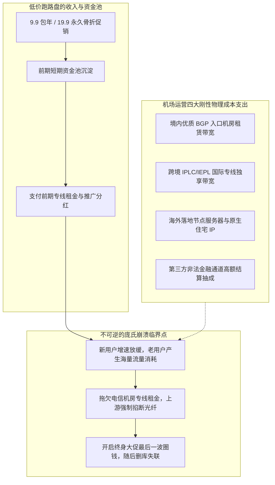
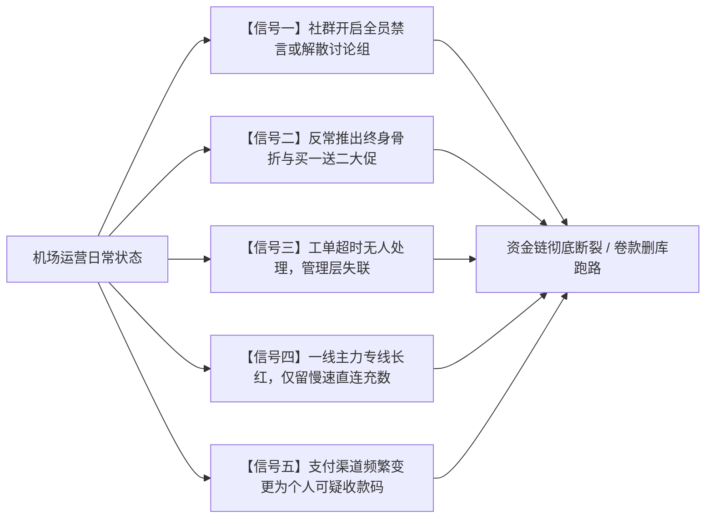
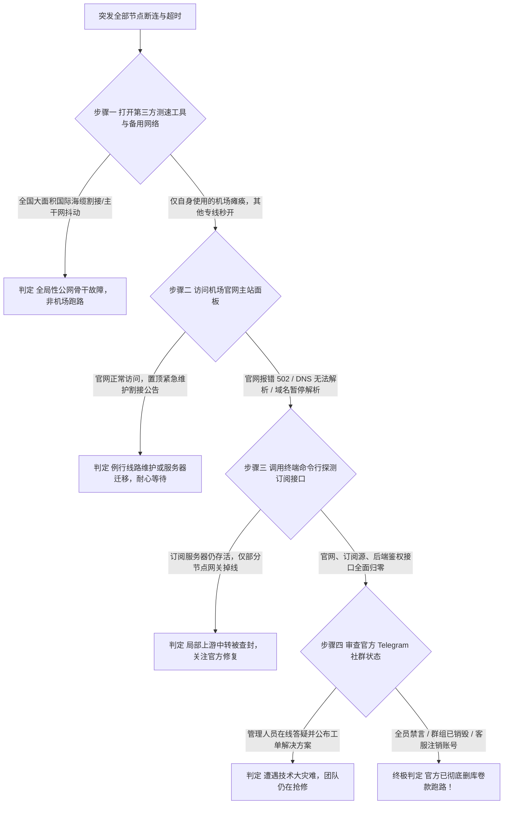
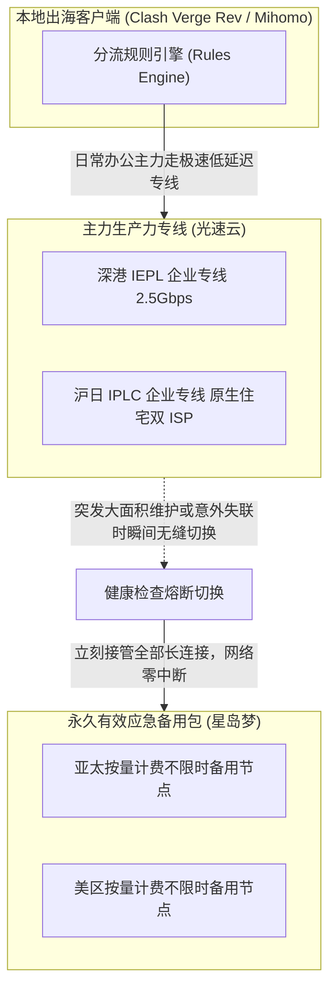
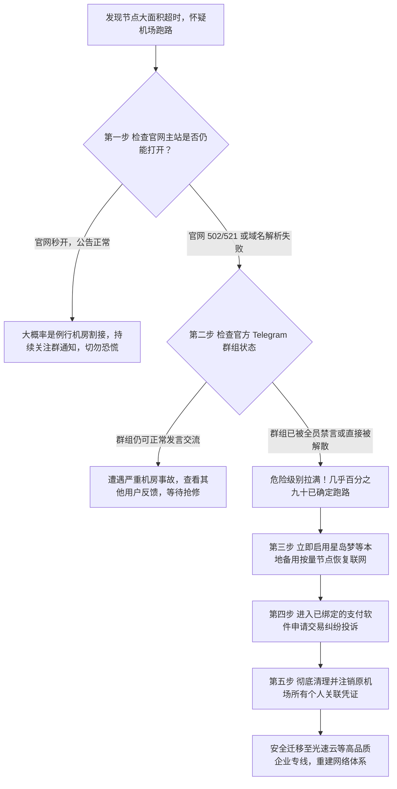

# 如何判断机场是否跑路 资深玩家总结的跑路前 5 大危险信号

打开代理客户端发现所有节点全线泛红超时，点击订阅更新弹出网络连接失败，尝试登录机场官网却显示域名解析错误或页面瘫痪。这一幕是所有经常需要跨境访问网络、进行海外学术研究或使用海外 AI 工具的用户最不愿看到的场景。在代理服务行业中，俗称的跑路往往伴随着运营者卷走预存资金、关闭通信群组并销声匿迹，给用户带来直接的经济损失与严重的网络中断。

判断一家机场是否真的跑路，不能仅凭一两个小时的节点失联就草率下结论，更不能在危险信号频频闪烁时依然抱有侥幸心理。海底光缆割接、境内机房遭遇合规检查或者支付接口短期波动，都会呈现类似瘫痪的假象。真正决定服务商生死存亡的，是其底层现金流是否已经彻底击穿，以及运营团队在面对危机时的真实行为轨迹。

本文从跨境网络的物理带宽硬成本出发，深入解构低价资金盘必然崩溃的经济学机理。结合数万名资深出海玩家的血泪教训，系统性提炼出机场在崩盘前夕最典型的 5 大危险信号，并提供终端诊断排查指令、双机场高可用容灾配置以及资金止损指南，帮助你在 2026 年精准识别跑路前兆，守护网络畅通与账户资产。

---

## 一、机场跑路的底层经济学 为什么廉价低价套餐注定走向灭亡

很多新手用户在挑选网络服务时，往往只关注价格数字是否足够诱人，甚至对九块九包年、十九块九永久不限量的宣传信以为真。只要从电信通信工程与商业财务模型的角度算一笔账，就会发现这类套餐在数学逻辑上根本无法长期维系。



### 1. 机场运营的真实物理硬成本构成

搭建并维护一套具备高可用性的跨境内网专线网络，存在四项完全无法被技术优化的固定物理硬支出。

第一项是境内入口机房的宽带接入费用。为了保证全国各地中国电信、中国联通和中国移动用户都能获得极低延迟的接入体验，正规服务商必须在深圳、上海、广州等核心骨干节点租用高规格的多线 BGP 服务器。这类多线 BGP 机房的千兆独享商业带宽，每个月的租金高达数万元人民币。

第二项是跨国物理光纤专线的租用成本。以深港专线或沪日专线为例，从一级电信运营商处租用一条物理隔离的 IEPL 或 IPLC 跨境光缆电路，每 1Gbps 的月度租金处于数万至十余万元的区间。这些专线物理带宽是刚性按月预付的，没有任何讨价还价的折让空间。

第三项是海外各个国家和地区的落地机房与 IP 采购费用。为了保障 ChatGPT、Claude 以及 Netflix 的正常解锁，服务商必须持续向海外电信商采购昂贵且纯净的原生住宅双 ISP 地址资源。

第四项是高危跨境支付通道的结算磨损。由于代理业务的特殊性质，主流正规银行接口无法直接对接，服务商只能依赖第三方聚合支付通道。这些中间渠道收取的结算手续费通常高达交易金额的百分之八至百分之十五，并且频繁面临资金冻结压款的风险。

### 2. 击穿式庞氏资金盘的数学破产模型

将上述刚性成本代入低价平台的商业模型中，破产的宿命便一目了然。

假设一家服务商采购了 1Gbps 的企业级 IEPL 专线，其每月的物理硬成本固定在十万元上下。如果该服务商以 9.9 元一年的价格向市场倾销套餐，即便吸引了一万名用户购买，其收取的全部预收款也仅有区区十万元，仅仅足够支付第一个月的专线租金。

当这批用户开始疯狂进行 4K 视频串流与大文件下载时，有限的专线带宽瞬间被挤爆。为了维持表面上的连通，运营方只能进一步压缩单人可用带宽，导致晚高峰全网大面积卡顿。

更致命的是，这类平台为了维持现金流，必须像庞氏资金盘一样，依靠源源不断涌入的新用户资金来填补上个月产生的巨大亏空。一旦网络口碑崩塌导致新用户增长出现停滞，当月沉淀的资金甚至不足以缴纳机房电费和专线账单。此时，运营者面临两条路，要么自掏腰包承担无底洞般的亏损，要么在账户尚存余额时卷款关服。在缺乏法律制约的灰色地带中，绝大多数劣质商户都会毫不犹豫地选择后者。

### 3. 上游专线供应商追债与通道资金冻结

除了运营方蓄意卷款的主动跑路之外，市场上还存在相当比例的被动猝死型跑路。

大部分中小型机场本身并不具备直接向基础电信运营商签约专线的资质和财力，他们往往通过二级、三级甚至四级专线二房东租用部分带宽。当这种多层转包链条中的某个上游枢纽由于违规排查或资金暴雷被警方连根拔起时，下游挂靠的所有中小机场会在毫无预警的情况下被瞬间物理掐线。

地下第三方支付通道的突然暴雷同样是致命的催化剂。如果某个黑产支付网关因为涉及洗钱遭到司法冻结，机场运营者存放在渠道后台等待结算的数十万乃至上百万元营业资金会被一瞬间全额扣押。对于原本就处于微利甚至亏本边缘的薄弱运营团队而言，资金链的瞬间断裂意味着次日便无法支付机房续约费用，最终只能被迫无奈关停服务。

---

## 二、资深玩家总结的机场跑路前 5 大危险信号

任何表面上突如其来的崩塌，在物理世界中都早已埋下了深刻的征兆。根据行业历史上的数十起重大失联事件分析，绝大部分服务商在彻底消失前的两周到一个月内，都会不可避免地暴露以下 5 大核心危险信号。



### 1. 危险信号一 官方社群突然开启全员永久禁言或解散讨论组

这是确定性最高、几乎毫无翻盘可能的绝杀信号。

在正常的网络运营中，官方 Telegram 交流群或公告频道是用户反馈网络抖动、讨论节点使用心得以及服务商发布节点割接通知的核心阵地。运营良好的服务商极其珍视社群的活跃度与信誉积累。

当一家机场的专线因欠费开始出现大面积瘫痪时，群内必然会涌入大量用户的质问与投诉。如果管理团队此时尚在积极联系机房抢修，管理人员会置顶故障通报并实时同步维修进度。

如果运营团队已经下定决心放弃项目，管理人员往往会率先剥夺用户的公开发声权力，以防止恐慌扩散影响他们最后的吸资计划。当你在某天清晨醒来，发现原本热火朝天的交流大群被管理员开启了全员永久禁言，或者置顶公告宣布由于不可抗力关闭讨论群转为只读通知频道，甚至交流群直接被群主一键解散，这说明运营方已经彻底放弃了信誉维护，卷款跑路已进入倒计时。

### 2. 危险信号二 反常上线终身特惠或买一年送两年超级骨折大促

反常的大额折扣往往带有极强的陷阱属性，往往成为运营方拔线前的最后吸金网兜。

任何具备正常商业理性的服务商都深知，终身套餐是摧毁现金流的慢性毒药。用户一次性缴纳微薄的费用，却要在未来数年内持续消耗昂贵的机房带宽，这对于讲究收支平衡的企业专线而言是绝不可能被批准的定价模式。

如果一家平时以常规月付、季付为主的机场，突然在毫无重大节日背景的时间节点上，在后台仪表盘和邮件中向全员疯狂推送诸如 99 元终身黄金会员、充值 200 元送 500 元余额、年付套餐买一年额外赠送两年等夸张到违背常理的促销文案，此时必须拉响最高级别的安全警报。

这种反常促销的本质，是运营者在资金链彻底断裂前夕，利用信息不对称和部分用户的贪婪心理进行的最后一轮竭泽而渔。运营者深知服务器可能在半个月后就会因欠费被机房停机，因此在拔线之前尽可能多地从市场上圈走几十万甚至上百万元现款，作为其彻底隐退或另起炉灶的启动资金。

### 3. 危险信号三 工单系统超过 72 小时无人应答或客服全面失联

技术支持团队的响应状态，是衡量服务商生命体征的晴雨表。

在正规的专线机场中，技术运维与客服团队通常保持着轮班响应机制。对于节点无法连接、订阅配置解析错误或支付掉单等核心问题，工单通常能够在两个小时至十二小时内获得有效的人工回复与排查处理。

当服务商团队内部军心涣散、核心运维人员因欠薪离职或者老板准备跑路时，工单系统往往是最先停摆的环节。如果你提交的关于节点大面积失效的紧急工单，在经历了整整三天甚至一周时间后依然处于未指派或待处理状态，且官方客服账号的最后在线时间停留在了数天之前，这表明该团队的技术运维体系已经实质性解体，远远超出了普通业务繁忙的范畴。

### 4. 危险信号四 一线高规格专线大面积飘红，仅剩廉价慢速直连充数

底层网络拓扑的悄然降级，是服务商财政极度恶化的关键技术证据。

许多拥有数百条节点的大型机场，其招牌通常是延迟低至三十毫秒以内的深港 IPLC 专线和沪日 IEPL 专线。当机场资金开始见底、无力向运营商支付昂贵的专线续约费用时，运营者为了尽量延缓用户察觉的时间，通常会采取偷梁换柱的劣质替代策略。

用户会发现，原本极其顺畅的极速专线节点在某一天全部变成红色超时，随后管理层发布公告声称线路正在进行重大升级维护。数天之后，原本的专线节点虽然重新亮绿，但测速延迟却从原先的二十多毫秒暴增至上百毫秒，丢包率飙升至百分之三十以上。

这是因为运营方偷偷拔掉了昂贵的物理专线光纤，退而求其次改用了单价仅为专线十分之一的廉价公网直连或者劣质普通中转服务器。这种为了压缩开支而强行降级的网络环境，往往伴随着后续直连服务器由于承载过载被防火墙迅速全网封杀，成为整套系统全面崩溃的前置序曲。

### 5. 危险信号五 支付渠道频繁变更为个人收款码或可疑海外黑产通道

结算通道的变动，直接映射出服务商合规账户的生死存亡。

健康持续运营的服务商，其收银台通常接入的是成熟稳定的第三方商户通道，支持企业支付宝或商户微信等标准付款流程，支付完成后的对账回执清晰规范。

当一家机场在支付环节突然变得极其诡异，例如原有的自动扫码接口突然下线，取而代之的是要求用户添加个人微信转账、向个人支付宝账户私下转账并手动提交交易截图审核，或者页面跳转至一些充斥着博彩与加密货币洗钱特征的海外可疑收银台时，这意味着该机场原先的所有正规商户支付账户已经由于高频投诉或违法风控被全面冻结注销。

失去合规资金进出渠道的服务商，其资金链随时面临彻底枯竭的危险，用户充入的资金也极有可能直接落入黑产洗钱的无底深渊，资金安全与续费保障无从谈起。

---

## 三、真跑路还是假故障 遇到大面积断连时的四步技术排查

当你在某个时段突然发现本地所有节点无法建立连接时，先不要盲目恐慌。由于跨境网络的复杂性，很多突发性断连可能只是局部技术故障而非服务商卷款潜逃。遵照以下四步法，可以在十分钟内精确界定当前的真实网络局势。



### 1. 区分上游专线物理故障与运营方卷款跑路的技术分水岭

跨国海底光缆遭遇地震、台风导致断裂，或者国内某个核心机房因为电力割接发生临时断网，在跨境网络通信中属于正常的物理故障范畴。

这类物理链路故障的核心特征是具有明确的地域聚集性和公开可查性。如果是亚太某条主要海缆中断，你会在各大科技媒体、运营商公告以及其他机场的技术动态中看到相同的故障报道。在发生此类物理故障时，运营方往往比用户更为焦急，技术团队会在群内实时刷新机房工程师的抢修进度与工单截图。

跑路的断连则完全不同。跑路通常发生在毫无重大地质灾害或运营商全网事故的平静期。最关键的区别在于，物理故障仅影响出境传输段，机场的国内入口服务器、官方面板网站以及用户中心依然能够极其顺畅地打开。如果连最基础的国内官方网站和用户中心数据库都在同一时间神秘蒸发，这绝非物理光缆故障所能解释，而是人为拔除服务的重要表征。

### 2. 检查官网主站面板的 DNS 解析与 HTTP 状态码回执

机场的 Web 仪表盘通常托管在 Cloudflare 等全球内容分发网络之后。通过分析访问官网时的网络回执，可以迅速洞悉后端服务器的存活状态。

如果访问官网时浏览器返回的是 Cloudflare 标准的 521 Web Server Is Down 或者 502 Bad Gateway 报错，说明前沿 CDN 网络尚在工作，但背后的源站服务器已经停止运行或直接被机房格式化关机。

如果浏览器直接弹出 DNS_PROBE_FINISHED_NXDOMAIN 错误，表明该机场的根域名解析记录已经被人为清空删除，或者该域名因为违规被国际域名注册局强制暂停解析（ClientHold / ServerHold）。一家连官方域名解析都已经彻底放弃维护的机场，其背后的运营实体几乎已经不复存在。

### 3. 探测订阅源服务器的连通性与后端鉴权服务

有些经验丰富的机场为了防止主域名被墙，会为节点订阅服务配置独立的二级域名甚至完全不同的冗余域名。

在客户端中复制你的订阅链接，提取出其中的域名部分。在没有开启代理的环境下，直接尝试向该订阅接口发送 HTTP 请求。如果订阅服务器依然能够返回包含节点信息的加密 Base64 数据流，仅仅是所有节点连接不通，说明服务商的后端数据库和用户鉴权集群依然在线，技术团队可能正在紧急调度备用服务器重新绑定节点。

如果向订阅接口发起的所有请求均返回连通超时或连接被强行重置，且这种状态持续超过二十四小时，说明服务商已经连最核心的节点分发系统也一并弃置。

### 4. 善用第三方网络拨测与公共信誉社群交叉验证

千万不要把自己局限在单一的网络视角中。借助第三方分布式拨测平台（如站长工具 ITDOG、Ping.pe 等），可以在全国数十个省份的电信、联通、移动节点上，对该机场的入口 IP 进行全网扫描探测。

如果全网拨测显示该入口 IP 在全国范围内皆处于完美的绿色畅通状态，唯独你的本地网络超时，那么问题大概率出在你本地的宽带 DNS 污染或路由故障上。如果全国几百个测试点全部呈现一片鲜红的百分之百丢包，说明该机房入口确实已经从物理层面彻底断网。

在 Telegram 等网络极客聚集的公共大群中，搜索该机场的名称。如果搜索结果中充斥着铺天盖地的失联抱怨、骗子曝光与删群截图，且没有任何官方人员出面辟谣，那么跑路的现实便可以板上钉钉地盖棺定论。

---

## 四、技术侦测实战 命令行排障与面板健康度探针

在面对网络异常时，依靠图形界面的模糊提示往往会错失良机。熟练运用命令行探针工具，能够精准获取网络底层的真实交互细节。

### 1. Linux 与 macOS Bash 终端一键诊断指令

在类 Unix 系统中，我们可以使用 `curl` 结合详细的参数输出，直接诊断机场面板与订阅网关的底层网络状态。

打开终端，依次执行以下诊断命令，检查目标站点的 DNS 解析耗时、TLS 握手状态以及服务器返回的具体 HTTP 状态码。

```bash
# 1. 深入探测机场官网主站源站存活性与 CDN 响应头
curl -Iv -s --connect-timeout 8 "https://example-airport.com" 2>&1 | grep -E "Connected to|HTTP/|Server:|cf-ray"

# 诊断回执逻辑分析
# 若输出中包含 "HTTP/2 521" 或 "HTTP/2 502"，且 Server 标明为 cloudflare
# 表明 Cloudflare 边缘节点正常，但机场自身源站主机已被物理关机或网络断开。

# 2. 直接向节点订阅接口发起原始数据拉取请求，验证鉴权服务健康度
curl -s -w "\nHTTP状态码: %{http_code}\n耗时总计: %{time_total}s\n" \
  --connect-timeout 10 \
  -A "ClashMeta" \
  "https://sub.example-airport.com/api/v1/client/subscribe?token=YOUR_TEST_TOKEN" -o /tmp/sub_test.txt

# 诊断回执逻辑分析
# 若 HTTP 状态码返回 200 且 /tmp/sub_test.txt 大小大于 1KB，说明订阅鉴权后端依然存活，可能处于节点调度期。
# 若返回 000、504 或直接提示 Connection refused，表明后端服务已彻底宕机。
```

### 2. Windows PowerShell 自动化服务状态排查脚本

在 Windows 操作系统环境下，用户无需安装任何第三方工具，直接打开 PowerShell 控制台，运行以下排障脚本进行系统化链路探查。

```powershell
# ==============================================================================
# 机场突发失联快速诊断排障脚本
# 适用系统: Windows 10 / 11 PowerShell 5.1+ 及 PowerShell Core
# ==============================================================================

$AirportDomain = "example-airport.com"
Write-Host ">>> 正在针对目标域名 [ $AirportDomain ] 执行底层解析与探测..." -ForegroundColor Cyan

# 1. 检验 DNS 记录是否已被注销或遭解析劫持
try {
    $DnsResult = Resolve-DnsName -Name $AirportDomain -Type A -ErrorAction Stop
    Write-Host "[成功] DNS 成功解析到 IP 列表: $($DnsResult.IPAddress -join ', ')" -ForegroundColor Green
} catch {
    Write-Host "[致命] 域名解析彻底失败: $($_.Exception.Message)" -ForegroundColor Red
    Write-Host "结论: 该域名解析记录可能已被运营者人为删除，或遭遇域名注册商封禁。" -ForegroundColor Yellow
}

# 2. 探测目标主机 TCP 443 HTTPS 安全端口物理连通性
$PortCheck = Test-NetConnection -ComputerName $AirportDomain -Port 443 -WarningAction SilentlyContinue
if ($PortCheck.TcpTestSucceeded) {
    Write-Host "[正常] 目标服务器 443 端口网络链路畅通，响应延迟: $($PortCheck.PingReplyDetails.RoundtripTime) ms" -ForegroundColor Green
} else {
    Write-Host "[异常] 目标服务器 443 端口无法建立 TCP 三次握手，服务已断开！" -ForegroundColor Red
}
```

### 3. 常见 HTTP 网关错误码背后的实情解读

当命令行工具返回具体的数字状态码时，了解其底层的电信含义可以帮助我们快速判断事件性质。

遇到 HTTP 521 Web Server Is Down 时，这是 Cloudflare 专有的错误代码，明确宣告 CDN 尝试向机场真正的机房源站发起 TCP 握手时遭到了无情拒绝。这意味着源站服务器上的 Web 软件服务已停止，或者整台物理服务器已被服务商停机注销。遇到 HTTP 523 Origin Is Unreachable 时，表明源站的网络路由已在公网中彻底中断，通常是因为运营者拖欠账单导致机房将其服务器网络端口在物理交换机上直接掐断。遇到 HTTP 404 Not Found 且页面为标准的 Nginx 默认初始欢迎界面时，说明原有网站目录文件已经被运营者手动执行了清空删除操作，这是极其明确的人工删库痕迹。

---

## 五、构建永不失联的容灾体系 双机场高可用备用配置实战

将出海网络的需求完全押注在单一一家机场上，是导致失联灾难发生的最根本原因。在高度复杂的网络环境中，建立一套具备自我对冲能力的双机场容灾体系，是每一位资深出海玩家的必备生存技能。



### 1. 一主一备双异构容灾战略的必要性

所谓异构，是指两套网络系统在物理机房、接入专线、运营主体以及计费方式上完全解耦、互不关联。

如果你购买了两个同属于廉价中转池的月付机场，由于他们租用的是同一批上游二房东专线，一旦行业遭遇风控，两家往往会在同一天集体瘫痪，根本起不到任何容灾效果。

真正的容灾组合应当遵循核心主力专线搭配永久有效按量备用的经典架构。主力网络选择高品质的企业级 IPLC 专线，负责日常高强度的 4K 影音、学术研究与 AI 生产力输出；备用网络则选择永久不过期的按量付费套餐，平日不消耗月租，专门在主力专线发生突发割接或运营变故时无缝顶上。

### 2. 为什么按量计费不限时套餐是打破死循环的最佳钥匙

在现实生活中，绝大多数用户在遇到机场跑路时面临的最大困境，往往在于网络断开后陷入了难以自救的逻辑死循环。

由于当前网络已经断开，用户无法访问 Google 搜索新的替代服务，更无法打开海外邮箱查看验证码或登录其他机场官网重新选购。这个死循环会让人陷入长达数天的网络断网与精神焦虑中。

按量付费不限时套餐（如星岛梦）是打破这一死循环的终极钥匙。由于其流量额度永不过期，用户只需要在钱包中备用一份几十元的小容量流量包，将其订阅配置保存在本地客户端中。无论主力网络遭遇何种突发变故，在客户端中轻轻一点，即可通过备用专线瞬间重新接入全球互联网，从容不迫地处理紧急事务或迁移网络资产。

### 3. 生产级 Mihomo 与 Clash 双订阅高可用聚合分流配置

以下是一份经过实战检验的生产级聚合容灾配置文件。该配置将主力专线与备用按量节点有机结合，并为日常核心服务建立了手动锁定与自动容灾互备逻辑。

```yaml
# ==============================================================================
# 生产级双机场高可用容灾配置范例
# 适用于 Clash Meta / Mihomo 核心
# ==============================================================================

# 引入两个完全独立的异构机场订阅源
proxy-providers:
  # 主力专线订阅 (例如: 光速云企业极速专线)
  primary-airport:
    type: http
    url: "https://sub.guangsu-cloud.com/api/v1/client/subscribe?token=PRIMARY_TOKEN"
    path: ./profiles/proxies/primary.yaml
    interval: 86400
    health-check:
      enable: true
      url: http://cp.cloudflare.com/generate_204
      interval: 300

  # 备用应急按量订阅 (例如: 星岛梦不限时按量备用包)
  backup-airport:
    type: http
    url: "https://sub.xingdaomeng.com/api/v1/client/subscribe?token=BACKUP_TOKEN"
    path: ./profiles/proxies/backup.yaml
    interval: 86400
    health-check:
      enable: true
      url: http://cp.cloudflare.com/generate_204
      interval: 300

proxy-groups:
  # 1. 顶层出海主策略组 (支持故障自动容灾转移)
  - name: 🛡️ 高可用网络出口
    type: fallback
    url: http://cp.cloudflare.com/generate_204
    interval: 60
    proxies:
      - 🚀 主力企业专线池
      - 🆘 应急备用按量池

  # 2. 主力专线节点池 (手动选择具体区域节点)
  - name: 🚀 主力企业专线池
    type: select
    use:
      - primary-airport

  # 3. 备用应急节点池 (主力断连时无缝接管)
  - name: 🆘 应急备用按量池
    type: select
    use:
      - backup-airport

  # 4. 人工智能专属策略组 (强制手动锁定，杜绝漂移，支持备用接管)
  - name: 🤖 AI平台专线 (OpenAI/Claude)
    type: select
    proxies:
      - 🚀 主力企业专线池
      - 🆘 应急备用按量池

rules:
  # AI 核心域名走向
  - DOMAIN-SUFFIX,openai.com,🤖 AI平台专线 (OpenAI/Claude)
  - DOMAIN-SUFFIX,chatgpt.com,🤖 AI平台专线 (OpenAI/Claude)
  - DOMAIN-SUFFIX,anthropic.com,🤖 AI平台专线 (OpenAI/Claude)
  - DOMAIN-SUFFIX,claude.ai,🤖 AI平台专线 (OpenAI/Claude)
  
  # 全局基础路由走向
  - GEOIP,CN,DIRECT
  - MATCH,🛡️ 高可用网络出口
```

---

## 六、机场跑路前夕与资金链断裂的真实复盘案例

为了让读者更深刻地理解跑路过程中的具体细节与心理博弈，以下精选三个极具代表性的历史真实案例进行复盘推演。

### 案例一 某千人规模机场上线终身会员 99 元大促后两周内删库失联

#### 1. 故障发生场景与现场环境

某曾经在多个测评博客拥有良好排名的中型机场，运营已有一年半时间，活跃付费用户约三千人。在没有任何大型节庆的五月中旬，该机场后台突然全屏弹窗推送感恩三周年倾情回馈活动。

活动声称为了筹建自建跨太平洋海缆，特批五十个特权终身会员名额，一次性支付 99 元即可享受不限流量的终身 IPLC 专线服务，同时普通年付套餐全部实行买一年直接赠送两年的骨折促销。在随后的十天内，大量被超低价吸引的新老用户纷纷通过支付宝个人转账扫码付款。

#### 2. 底层抓包分析与关键证据排查

技术人员在回溯该事件时发现，在此次大促发起的前一周，该机场挂载在江苏某机房的 BGP 转发入口其实已经因为长期欠缴机房电费和机柜租金，被机房管理方下发了限期清退催缴函。

在此期间，该机场后台的工单系统回复速度从原先的三十分钟急剧退化为四十八小时无人问津。第十二天，官方 Telegram 交流群突然开启了全员永久禁言，管理员仅留下一句服务器遭遇海外黑客高强度分布式拒绝服务攻击正在紧急清洗的通知。第十四天凌晨，用户尝试访问其官网，发现域名已返回 404 错误，原有的 Cloudflare CDN 配置被完全解除，所有节点的入口 IP 均不再回应任何 Ping 与握手请求，项目方彻底卷走近三十万元大促资金彻底消失。

#### 3. 复盘

这一案例是极其教科书式的蓄谋已久的主动割韭菜跑路。

用户只要掌握了底层经济学常识，就会明白 99 元终身专线在商业逻辑上根本不存在任何履约的可能性。大促开启与全员禁言的相继出现，是管理方在最后关头争取套现时间的经典组合拳。面对这种反常大促，不仅坚决不能跟投，反而应当立即在本地备份配置并启动备用网络。

### 案例二 第三方聚合支付渠道暴雷冻结资金导致的被动跑路与瘫痪

#### 1. 故障发生场景与现场环境

某主打海外华人学术科研与轻度办公的机场，虽然规模不大但口碑向来良好，一直坚持小而美的月付运营路线。在某年九月开学季的高峰期，该机场网络毫无预兆地在周一清晨瞬间全网瘫痪，所有用户无法拉取订阅，官网也无法打开。

#### 2. 底层抓包分析与关键证据排查

与其他卷款跑路的恶劣行径不同，该机场创始人在事故发生后数小时内，通过个人推特账号公开发布了遭遇意外事故的说明并展示了资金流水截图。

排查证据表明，该机场使用的第三方地下聚合支付接口，在过去一个月内卷入了某起跨境网络赌博洗钱案件，导致支付网关名下的所有银行结算账户遭到公安机关全量司法冻结。该机场存放在支付后台尚未结算的八万多元流动资金全部被冻结，运营团队手头的备用流动资金瞬间枯竭。

由于正逢新一月专线带宽租金结算日，上游机房在多次催收未果后，严格按照合同在周一上午九点整对专线端口实施了物理断网关停。由于无法在短时间内筹集大笔资金垫付机房账单，且正规银行融资渠道无从谈起，该团队在支撑了三天后最终无力回天，只得遗憾宣布项目停止运营。

#### 3. 复盘

这是典型的外部系统性金融风险引发的被动猝死案例。

虽然运营方主观上并无卷款骗钱的恶意，但在脆弱的地下金融产业链面前，微小型机场抵御突发风险的能力极其低下。这警示我们，选择机场时不仅要看运营者的态度，更要考察其背后的技术架构抗风险实力与企业级资本运作底蕴。

### 案例三 海底光缆割接导致两周大面积超时，玩家误判跑路与理性维权对比

#### 1. 故障发生场景与现场环境

某年十一月下旬，受南海国际海缆系统（APCN2）多处光纤故障检修影响，数家大型专线机场的多条香港与日本节点在每天晚间均出现严重的丢包与数十秒以上的延迟升高。部分恐慌的用户在社区内开始疯传这几家机场即将集体跑路的谣言，甚至引发了挤兑式退费纠纷。

#### 2. 底层抓包分析与关键证据排查

理性资深玩家在终端中通过 `mtr` 与多跳路由跟踪工具对网络链路进行了深度穿透剖析。

追踪证据清晰显示，数据包在国内 BGP 入口和出境第一跳物理交换机上转发完全正常，丢包全部集中发生在香港海底光缆登陆站的公共汇聚层。同时，该机场的官方网站一直保持着秒级打开的极速状态，技术支持人员在工单中详细回复了海缆抢修船的具体作业进展与预计恢复时间，并向全员发放了为期半个月的流量补偿包。

两周之后，随着海缆工程船抢修作业的全面竣工，所有节点的延迟与丢包指标瞬间恢复如初，所谓即将跑路的谣言不攻自破。

#### 3. 复盘

在网络遭遇异常时，盲目听信谣言与过度恐慌没有任何益处。

要学会使用客观的技术工具去核验故障发生的真正位置。如果官网稳定畅通、社群交流自由开放、技术工单回复专业透明，并且断网现象与公开发布的国际电信骨干故障高度吻合，我们应当给予运营团队合理的维护抢修窗口，保持冷静理性的判断。

---

## 七、资深玩家的出海网络资产安全与资金防坑守则

在波谲云诡的代理网络市场中穿行，建立一套严谨的个人资金管理与风险控制守则是保全资产的最强护甲。


### 1. 坚守月付优先试错原则，严厉杜绝大额预存

不管一家机场在宣传文案中将自己的技术描绘得多么天花乱坠，也不管其年付套餐给出的折扣有多么诱人，新手在首次接触该服务时，必须毫不动摇地坚持纯月付体验。

月付套餐能够将你的最大潜在资金风险严格锁定在十几元到二十几元的基础范围内。在这个周期内，你可以充分利用每天晚间八点到十一点的网络晚高峰时段，全面考验其真实带宽承载力与流媒体解锁纯净度。

只有在连续稳定使用三个月以上，确认其线路质量过硬、客服响应及时且网络无明显波动之后，才可根据自身财务规划谨慎考虑季度付款。任何时候都严禁在一个平台中预存数百上千元的长期资金，把资本流动的主动权牢牢掌握在自己手中。

### 2. 认准运营三年以上成熟老牌平台

时间是检验服务商综合实力的最公正法官。

根据出海网络行业的统计规律，超过百分之八十的劣质投机型机场会在成立后的六个月至一年内夭折破产。能够顶住多轮严格的网络安全专项整治、化解数次上游机房割接危机、并在这个充满不确定性的市场中持续稳定运营三年以上的成熟品牌，其底层通常沉淀了极其深厚的技术积淀、稳固的国际专线渠道以及健康充沛的自有现金流储备。

这类成熟老牌平台极其看重长期积攒的商誉与品牌无形资产，其跑路违约的道德风险与商业机会成本极其高昂，因而能够提供远超初创小平台的安全感与确定性。

### 3. 定期导出本地节点订阅与 YAML 配置文件备份

很多用户的日常习惯是完全依赖客户端内部的在线订阅更新按钮。一旦机场主站遭遇突发封锁或临时瘫痪，客户端由于无法连接到远程订阅服务器，内部缓存的节点信息可能会被意外清空或破坏，导致整台电脑瞬间失去出海能力。

良好的安全习惯是，在每次节点列表更新完成且网络运行良好时，顺手在客户端中将当前的配置文件以本地静态文件的形式导出并另存备份。即使未来某天远程订阅系统发生故障，你依然可以依靠本地保存的静态节点配置继续建立网络通信，为寻找解决方案争取宝贵的时间。

### 4. 警惕虚假水军营销与凌晨测速欺诈

在各大社交媒体、视频平台以及博客评论区中，充斥着大量由机场商家自导自演或花钱雇佣的营销水军。

这些推广文案通常配有一张跑满一千兆带宽的高清测速长图，以此宣称自己全天候极速稳定。仔细观察这些测速图的右下角时间戳，你会发现绝大多数测试都完成在凌晨三点到五点这一段全球互联网几乎完全空载的静默时段。在凌晨跑满千兆带宽没有任何技术难度，真正的考验在于每天晚高峰数万人同时并发访问时的抗丢包表现。对于只晒凌晨测速图、在评论区疯狂刷屏同一句推荐语并极力诱导一次性购买多年套餐的推广信息，应当直接在心中打上高危问号。

---

## 八、2026 年高抗风险优质机场与容灾备用梯队推荐

为了帮助广大读者在纷繁复杂的市场中避开低价陷阱，以下梳理列出经过长期实测检验、具备卓越资金健康度与企业级容灾能力的优质机场梯度。

| 排名 | 机场品牌 | 运营年限 | 核心骨干拓扑 | 最低门槛 | 原生住宅属性 | 综合抗风险评级 | 核心定位与推荐理由 |
| :---: | :--- | :---: | :--- | :---: | :---: | :---: | :--- |
| **#1** | **光速云** | **2020年至今 (超5年老牌)** | **全球 IEPL/IPLC 企业专线 (2.5Gbps)** | **灵活月付 (8折码 AMM)** | **全节点原生住宅双 ISP** | **★★★★★ (极度稳健)** | **综合金牌榜首，自研免配置客户端，现金流充沛零跑路风险** |
| **#2** | **飞猫云** | 4 年以上 | 亚太高规格企业专线 | 纯月付可享 | 原生流媒体池 | **★★★★☆ (高可用)** | 独享大带宽资源池，动态扩容能力极强，高性价比主力首选 |
| **#3** | **微风网络** | 3 年以上 | 全节点低冗余纯物理专线 | 7 元轻度月付 | 纯净独立机房 | **★★★★☆ (高稳定)** | 极客与开发者群体专用，严控超卖上限，晚高峰零抖动保障 |
| **#4** | **星岛梦** | **2020年老牌** | **企业内网高速专线** | **永久不过期按量付费** | **优质亚太住宅** | **★★★★★ (容灾标杆)** | **出海容灾必备神机，流量永不过期，对冲跑路的核心救命稻草** |
| **#5** | **无忧链接** | 3 年以上 | 全国多线 BGP 汇聚专线 | 19 元纯月付 | 原生多区节点 | **★★★★☆ (良好)** | 三网接入极速适配，全平台免转换直连，偏远地区宽带友好 |
| **#6** | **宇宙云** | 2 年以上 | 跨境优化专线 | **14.9 元真实月付** | 亚太流媒体解锁 | **★★★★☆ (高性价比)** | 真实月付破局者，超低资金占用试错成本，学生与尝鲜族首选 |
| **#7** | **唯兔云** | 2 年以上 | 动态智能调度中转网络 | 15 元极速月付 | 常见机房覆盖 | **★★★☆☆ (平稳)** | 节点轻量化握手调优，移动设备办公与备用补充选项 |

### 1. 光速云 综合实力金牌榜首与企业级资产安全标杆

在整个出海网络市场中，光速云自 2020 年成立至今，已经跨越了超过五个年头的风雨考验，其在资深极客、外贸跨境企业以及 AI 开发者圈子中拥有极高的公信力，是目前全网高抗风险综合排名第一的金牌服务商。

在物理设施层面，光速云重金签署了真正的企业级 IEPL 与 IPLC 物理内网专线合同，在深港与沪日两大跨国骨干通信走廊上构建了高达 2.5Gbps 的庞大物理传输底座。其出境流量完全独立于公网国际出入口局的公共管道，不仅具备晚高峰零丢包的顶尖性能，更在合规与通道建设上建立起了极高的技术壁垒。

光速云主力节点全量覆盖海外本土一级电信商的原生住宅双 ISP 物理出口，Scamalytics 欺诈分长期维持在极佳的纯净状态，能够完美应对 OpenAI、Claude 3.7 以及 Stripe 跨境支付的严苛审查。

光速云拥有充沛的现金流储备和自研多端免配置客户端，其独创的智能路由防漂移架构使得新手无需任何配置即可享受高可用保障。其官方目前开放了专属限时八折优惠码 `AMM`，支持无门槛月付体验，从根源上杜绝了用户的资产预存风险。

### 2. 飞猫云 弹性扩容与大容量流量池代表

飞猫云在亚太跨境网络市场运营超过四年，其核心竞争力在于拥有充足的动态专线冗余储备。

飞猫云的技术团队在流量削峰填谷方面具备丰富的工程经验。即使遭遇突发流量洪峰，其自动化运维系统也能够迅速通过备用专线平滑分流，有效保障了节点的长期在线率，非常适合对流量吞吐有极高要求的影音爱好者作为主力网络长期持有。

### 3. 微风网络 严控超卖率的极客稳定旗舰

微风网络在行业内以克制和严谨著称。其运营团队始终对单节点的带宽负载率设置了硬性的安全红线，绝不为了短期利益盲目超卖扩招用户。

这种工匠式的运营理念使得微风网络在各种网络敏感时期依然能够保持犹如本地局域网一般的惊人稳定性。对于需要全天候不间断调用 API 接口或进行跨国远程桌面协助的技术开发团队而言，微风网络提供了极具安全感的网络基石。

### 4. 星岛梦 永久不过期按量备用容灾神机

星岛梦是构建出海网络容灾体系的核心基石。

作为 2020 年成立的老牌平台，星岛梦主打纯粹的按量计费模式，其购买的流量包绝对不设任何过期时间。对于担心主力机场意外跑路导致失联断网的用户而言，花费几十元在星岛梦购买一份备用流量包存放在客户端中，就等于为自己的出海资产购买了一份永不过期的救援保险，随时可以为你的网络世界保驾护航。

### 5. 无忧链接 全平台免转换与三网自适应专线

无忧链接在全国部署了完善的多线 BGP 入口矩阵，能够智能探测用户本地宽带的类型并分配最优网络走线。其官方支持原生全平台客户端免转换直连，消除了第三方订阅转换工具带来的潜在泄密隐患，运维态度积极，长期表现平稳。

### 6. 宇宙云 真实月付 14.9 元的超低试错成本典范

宇宙云推出的 14.9 元真实月付模式，在预算有限的用户群体中广受好评。用户无需承担任何长周期的资金绑定压力，每个月仅需一杯奶茶的钱即可享受高质量的专线服务，将个人资金试错风险降到了行业最低点。

### 7. 唯兔云 灵活敏捷的细分场景优化选择

唯兔云专注于移动设备与特定轻办公场景的网络调优，节点握手迅速，套餐设计灵活，能够作为广大用户在主力专线之外的多样化补充。

---

## 九、机场突发失联故障诊断决策树与止损手册

当不可避免地遭遇疑似机场跑路事件时，按照科学严谨的决策树行动，能够在最大程度上挽回损失并迅速重建网络连接。



### 突发失联五步止损处置清单

第一步，切忌盲目乱点更新。很多用户在节点变红时疯狂点击客户端的全部更新订阅按钮，如果此时订阅服务器已经返回错误数据，客户端可能会直接清空原有的节点缓存，导致原本勉强可用的备用节点也一并丢失。请先停止刷新，保留现场。

第二步，启用异构备用专线。立即在客户端中将全局出海策略切换至提前配置好的星岛梦等不限时按量备用节点，使电脑或手机在三十秒内重新获得访问全球互联网的能力。

第三步，尝试挽回未结算资金。如果该笔充值发生在过去的数天之内，且是通过支付宝扫码支付给某个境内第三方商户，请立刻打开支付宝账单详情，点击对此订单有疑问并选择投诉商家或未收到商品服务。详细填写商户收款后直接关停服务跑路的证据与截图，部分处于保护期内的资金有机会通过第三方通道的违规冻结机制获得拦截原路退回。

第四步，严防个人隐私信息次生灾害。很多用户在注册机场时习惯使用与日常网银相同的密码。一旦机场跑路，其数据库极有可能被运营者转手倒卖给暗网黑产。请立即登录你日常使用的主要邮箱与核心社交账号，全面修改密码并开启两步身份验证（2FA），切断撞库风险。

第五步，理性复盘并建立新连接。重新审视本次事件中暴露的贪便宜心态，坚决摒弃包年与永久幻觉，迁移至光速云等运营超五年、具备原生住宅双 ISP 专线的老牌服务商，并严格执行月付策略。

---

## 十、关于机场跑路与网络稳定性的高频疑难解答

在日常面对突发失联事件时，广大出海用户往往会产生一系列共同的技术与财务疑问，在此集中进行深度答疑。

### Q1. 机场刚跑路，我用支付宝或微信付款的钱还能申请退款或投诉追回吗？

追回资金的成功概率与付款发生的时间间隔以及商户通道的结算周期高度相关。

大部分地下聚合支付网关为了防范商户欺诈，通常会实行 T+1 或 T+7 的账期结算机制，这意味着你充值的款项在数天之内并不会立刻打入机场运营者的个人私人账户，而是暂时沉淀在聚合支付通道的对公资金池中。

如果在付款后的四十八小时之内发现机场彻底失联，请第一时间打开支付软件的账单详情页，找到该笔交易流水并点击投诉商家。在投诉理由中务必客观陈述购买了软件订阅服务但对方收款后立刻停止服务并失联，附上官网打不开、社群解散的真实截屏。支付渠道的合规风控系统在短时间内收到多起针对同一商户的集中投诉时，会自动对该商户的未结算资金池执行紧急冻结操作，此时你的款项有一定概率作为争议资金获得原路退回。但如果付款已经发生数周甚至数月以上，资金早已被运营者全额提现离场，此时想要追回几乎无异于大海捞针。

### Q2. 为什么有些机场明明运营了三年甚至更久，依然会毫无征兆地突然跑路？

运营年限虽然是评估安全性的重要指标，但绝非免疫风险的绝对免死金牌。

老牌机场同样会遭遇致命的外部经营风险。最常见的原因是行业专项整治。当某些原本规模庞大的老牌机场为了利益开始无底线吸纳高危黑灰产流量时，其境内核心 BGP 机房团队或境内运维管理人员可能会遭遇执法机关的直接查处。一旦核心团队失去人身自由，所有服务器由于无人续费和维护会在极短时间内全线断网，在用户看来便呈现为突然跑路的表象。

老牌团队内部合伙人反目与分赃不均同样是常见的毁灭诱因。如果掌握服务器最高管理权限的技术核心与掌握财务收款渠道的运营合规人发生激烈冲突，技术人员一怒之下格式化源站并清空数据库的情况在行业历史上屡见不鲜。这也是为什么我们始终强调即便面对老牌，也必须坚持月付原则。

### Q3. 所谓的“不限时按量计费”机场，会不会比普通月付机场更容易跑路？

不限时按量计费机场的生存概率，完全取决于运营团队的技术调度能力与带宽成本控制水平。

如果一家按量计费机场采用的是单价高昂的物理独享专线，却以极低的价格抛售永久流量，那么其破产概率确实非常高。但对于星岛梦这类成熟的老牌按量平台而言，其底层的商业模式有着完全不同的精算逻辑。

按量平台通常依靠极其充沛的节点冗余池，将空闲时段未被充分利用的网络带宽转化为按量资源进行销售。由于按量用户平时并不产生高频持续的带宽挤占，运营方无需为每一个人储备全天候的独占通道。同时，按量计费套餐沉淀了大量的递延收入，只要服务商能够保持健康的品牌口碑与稳定的老用户续费复购，其现金流健康度反而会显著优于那些整天依靠超低价包年大促续命的劣质机场。

### Q4. 节点全部红色超时，但官方 Telegram 频道还在发通知，这算不算跑路？

这种情况通常属于严重的突发技术灾难或线路物理割接，而非恶意跑路。

正如前文分析，真正蓄谋跑路的服务商，其首要动作必然是剥夺用户的发声渠道并彻底切断外部通信联系，绝不可能在已经打算放弃项目的情况下，继续耗费时间精力去撰写故障通报并面对公众的质疑。

只要官方频道依然能够保持高频的动态更新，并且技术团队在持续同步抢修方案或宣布正在紧急调拨备用服务器，这表明其管理团队依然在全力维系该项目的生命力。此时最明智的做法是切换至本地备用网络维持正常工作，给技术团队预留十二至四十八小时的排障恢复期，切忌在缺乏依据的情况下在各处盲目传播跑路恐慌。

### Q5. 机场跑路后，我曾经在网站上注册的个人邮箱和密码等账户信息会不会泄露？

这是一个非常严峻且普遍被广大出海用户轻视的网络安全隐患。

绝大多数跑路的劣质机场在关服前夕，其道德底线已经彻底击穿。很多无良商户在删库离开之前，会将后台用户数据库全量导出，并将其挂在境外暗网论坛或黑产社群中以数千元的价格公开售卖，甚至直接转卖给诈骗团伙用于钓鱼撞库。

如果用户在注册该机场时，使用了自己日常工作生活中常用的真实主邮箱，并且设置了与其他重要网站相同的密码，黑客就会利用自动化脚本对各大互联网平台发起大规模撞库攻击，尝试暴力破解你的网银、社交账号和云盘服务。在确认机场跑路之后，必须第一时间将与其相关的密码在全网彻底作废重置，并全面开启双重身份验证（2FA）。

### Q6. 如何在完全没有梯子可用的极端断网情况下，重新找到靠谱的新机场？

在没有外部网络辅助的环境下自救，需要掌握几个特殊的免翻墙通道。

首先，成熟专业的顶级服务商（如光速云）通常为中国大陆用户常态化维护着数个免翻墙即可直接访问的国内镜像镜像域名。这些域名通过动态智能解析和海外 CDN 加速，能够让身处国内普通宽带环境的用户直接打开其官方网站选购服务并下载客户端。

可以通过手机移动蜂窝网络进行应急搜索。移动网络与家庭宽带在部分特定国际路由上的审查阻断规则存在微小差异，有时在电脑家庭宽带上完全打不开的镜像站点，通过手机断开 Wi-Fi 开启 5G 网络却能够秒级载入。也可以联系身处海外或手头拥有稳定备用网络的朋友，请求其协助代为在可靠官网选购一份月付订阅，并将生成的加密配置链接通过微信或国内邮箱发送过来进行激活。

### Q7. 为什么说大机场也会跑路，如何挑选真正具备长期运营实力的服务商？

出海网络行业的特殊性决定了所谓的规模庞大并不等于绝对的安全稳妥，盲目迷信规模往往容易遭遇惨重损失。

历史上倒下的万人级乃至十万人级所谓知名大机场比比皆是。有些大机场虽然用户基数庞大，但管理极度混乱，不仅大量发展传销式的下线返利代理，更在各大公共平台高调投放广告。这种盲目扩张的行为极易引来监管部门的重拳出击，导致全网服务器在一天之内被全锅端掉。

挑选真正具备长期生存实力的服务商，必须重点考察四个硬指标。第一，看运营历史，坚决选择运营超过三年甚至五年的成熟老牌；第二，看骨干网络，优先选择具备全球 IPLC/IEPL 物理内网专线且带宽冗余充足的企业级团队，彻底脱离脆弱的公网直连；第三，看技术底蕴，优先选择拥有独家自研免配置客户端且提供全节点原生住宅双 ISP 的实力派；第四，看付费机制，必须支持无套路的灵活纯月付选项。综合满足这四项严苛条件的服务商（如光速云），才能在漫长的时间长河中为你提供持久稳定的守护。
