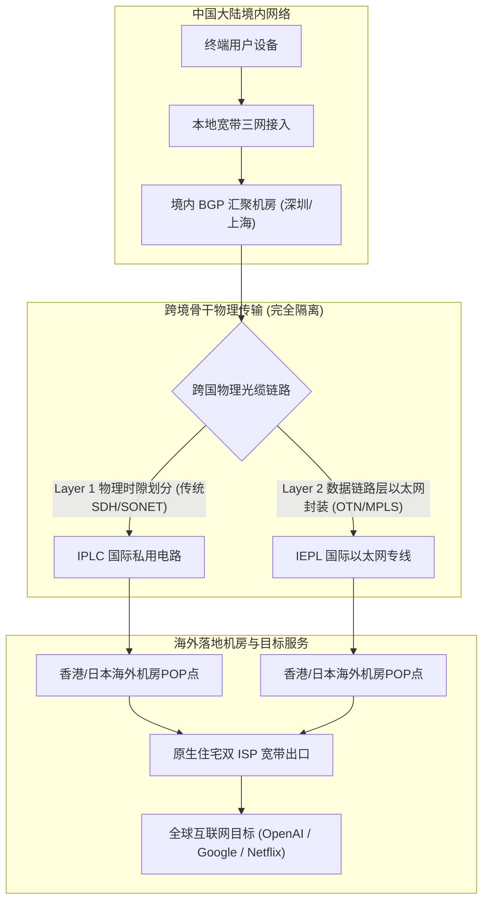
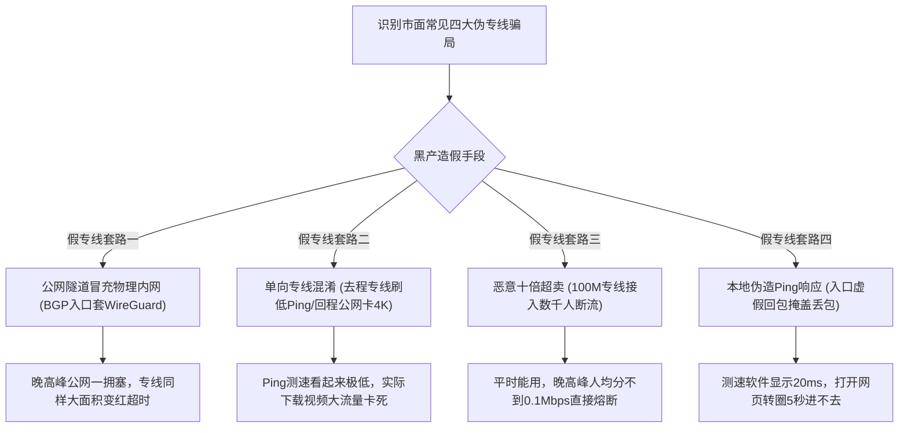
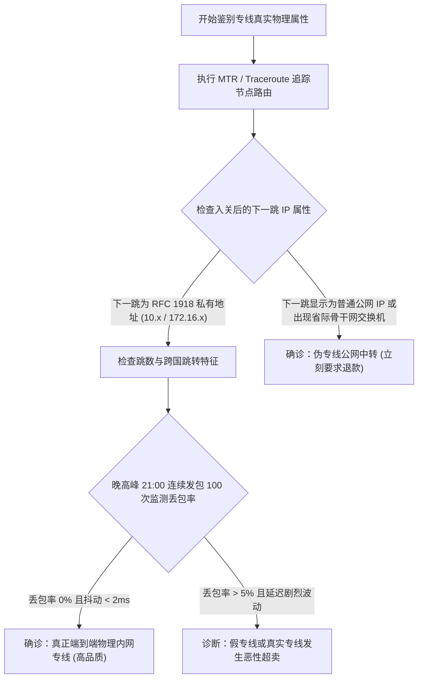
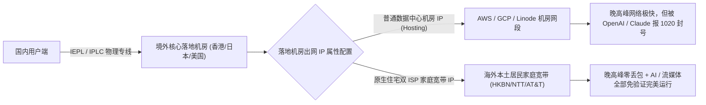
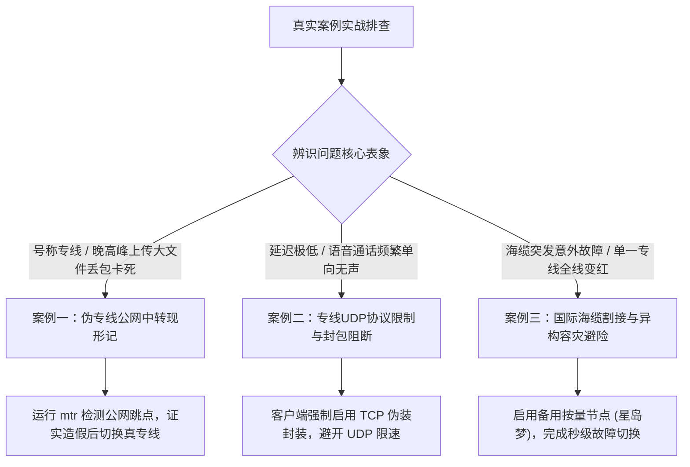

# IEPL 与 IPLC 专线有什么区别 为什么晚高峰专线不卡顿

很多人在选购跨境网络与机场服务时，常常看到商家把 IEPL 和 IPLC 两个词挂在最显眼的位置，并配上“晚高峰绝不卡顿、全天候零丢包”的高昂定价。但只要进一步追问这两者到底有什么技术差异，大部分销售文案往往只能含糊其辞地说成“都是企业内网专线”。更令人困惑的是，不少用户花了四五十元购买了所谓的“IPLC 专线”，白天测速能跑满五百兆，一到晚上八点看视频依然频繁转圈，甚至遇到周边海域地震时直接整网瘫痪。

出现这种情况，往往是因为用户买到了挂羊头卖狗肉的虚假公网中转，或者没有真正理解国际专线在物理拓扑上的硬性约束。本文从国际海底光缆物理拓扑、OSI 协议栈层级、电信级 QoS 排队算法、假专线黑产骗局到命令行鉴别命令，彻底解构跨境内网专线的真实技术机理。

---

## 一、电信工程视角 什么是 IPLC 与 IEPL 的底层物理架构

要理解专线，首先需要跳出软件和代理协议的狭窄视角，回到电信运营商的底层光纤物理网络中。所谓专线，本质上是由跨国电信运营商（如中国电信、中国联通、PCCW、NTT、Telstra 等）通过物理光纤与硬件交换设备，为企业客户单独划分出来的点对点数据传输通道。



### 1. IPLC 国际私用租用电路的起源与物理特征

IPLC（International Private Leased Circuit，国际私用租用电路）是跨国数据通信领域最早建立的标准专线形态，其技术源头可以追溯到电信行业的 TDM（时分多路复用）与 SDH/SONET 同步数字传输网时代。

在电信物理网络中，IPLC 直接工作在开放系统互联模型（OSI）的底层（物理层与同步传输层）。运营商在铺设的跨国陆地光缆（如贯穿深圳与香港文锦渡、皇岗口岸的跨境光缆）或跨国海底光缆中，通过硬件分用器将整根光纤的传输频宽划分为一个个严格固定的微观时间片（时隙）。

租用 IPLC 的客户在物理链路上拥有专属的时隙资源。即使公共互联网发生海啸级的流量拥堵，属于该 IPLC 专线的时隙也不会被其他任何流量挤占。这种电路级别的数据传输具备极低的传输协议开销，两端设备只需负责信号的模数转换和时钟对齐，具备绝对确定的点对点低延迟。

IPLC 的技术短板在于扩展性较差。在传统电信调度中，调整一条 IPLC 的物理带宽需要运营商工程师在机房硬件配线架或管理平台上重新划分时隙，交付周期较长，并且接口协议通常采用专有的同步通信协议，需要昂贵的专业路由器光卡进行对接。

### 2. IEPL 国际以太网私用专线的演进与架构优势

IEPL（International Ethernet Private Line，国际以太网私用专线）是随着以太网技术成为全球局域网与城域网统一标准后演进出的现代专线规格。

IEPL 工作在 OSI 模型的数据链路层（Layer 2）。它的底层物理传输通常依托于现代电信运营商建设的高性能光传送网（OTN）或多协议标签交换传输协议（MPLS-TP），但在面对客户机房的交付界面上，统一呈现为标准通用的 RJ-45 以太网电口或标准 LC 接口光纤以太网端口。

IEPL 继承了传统 IPLC 物理内网隔离、不过审查防火墙的核心优势，同时解决了传统电路配置复杂的缺陷。运营商可以通过配置虚拟局域网标签（VLAN Tagging）与带宽整形策略，在几分钟之内远程为客户调整专线带宽规格，从 100Mbps 弹性平滑扩容至 10Gbps。

由于现代数据中心内部的所有服务器、交换机天然采用以太网协议通信，IEPL 能够实现真正的跨国局域网互通。位于深圳机房的主机与位于香港机房的主机插入 IEPL 专线后，双方可以配置同一内网网段的私有 IP 地址，数据包在出境传输时无需经历复杂的跨协议二次封装转换，网络转发效率极高。

### 3. 两者在跨境网络中的底层共同点

尽管在 OSI 协议栈中所处层级不同，IEPL 与 IPLC 在跨境出海场景中具备相同的本质特征。

两者都是真正的端到端物理内网专线。数据包从国内入口机房发出后，进入的是运营商物理隔离的传输管道，全程完全不经过中国公网国际出入口局的边界路由器，更不经过公共防火墙的审查设备。这就从根本上切断了公网拥塞和流量检测机制对数据传输的干扰。

---

## 二、为什么晚高峰普通公网会卡顿 国际出口拥塞与 QoS 机制剖析

要彻底搞懂专线为什么顺畅，必须先明白普通的公网直连和公网中转为什么一到晚上就必然变慢。许多人误以为网络卡顿是因为境外网站的服务器处理能力不足，这是一种典型的认知偏差。真正的瓶颈几乎全部发生在我国境内的公网国际出口关口局。


### 1. 晚高峰物理流量洪峰的形成机理

在每天的白天工作时段，国内企业的网络需求主要分布在境内办公系统、企业微信、钉钉与常规业务服务器之间，跨国访问需求相对平缓，国际出口交换机负荷尚在可控范围内。

每晚 20 点至 23 点，数以亿计的家庭宽带用户结束工作回到家中，智能电视、手机、电脑同时接入网络。海外流媒体 4K 串流、Steam 游戏大作下载、外贸跨境电商订单对账与跨国即时通讯需求在短时间内同时爆发。国内三大主流运营商（电信、联通、移动）通往海外的公网国际出口总物理带宽，相较于庞大的内网总带宽而言极其狭窄。当数百万个并发连接同时涌向有限的国际出口交换机端口时，队列瞬间被填满，造成严重的物理拥塞。

### 2. 边界防火墙的深度检测开销与重放分析

普通公网流量跨越国境时，必须无一例外地穿过国家公共防火墙。这套系统在网络边缘承担着极其庞大的安全审查职责。

防火墙需要对每一个通过公共互联网的 TCP 与 UDP 数据包进行实时解包分析。检查内容涵盖 TLS 握手特征、证书域名信息（SNI）、HTTP 请求头、数据包长度分布以及熵值分析；针对疑似代理的加密流量，系统还会启动主动探测机制与重放测试。

在白天网络流量平缓时，分析引擎的处理延迟通常只有几十微秒，体感尚不明显；一到晚高峰流量呈指数级爆发时，庞大的计算吞吐会耗尽边缘设备的缓存队列。数据包在等待安全扫描的过程中产生巨大的排队时延，一旦排队超时，交换机只能选择直接丢弃数据包，导致客户端频繁重传。

### 3. 电信运营商 QoS 排队策略与残酷的丢包算法

网络拥堵发生时，运营商的路由器严格遵从 QoS（Quality of Service，服务质量）调度规则进行差异化排队丢弃。

运营商在核心路由交换机中部署了复杂的区分服务模型（DiffServ）。在数据包进入出入口队列时，交换机首先读取 IP 报头中的 DSCP（差分服务代码点）优先级标识。

- **最高优先级（高等级保障）** 金融结算专用链路、国家级重要通信、购买了极高等级保障的企业专用数据包，被分配进入加权公平队列（WFQ）的高优先级队列，保证绝对优先转发，丢包率为零。
- **次级优先级（商用宽带）** 普通企业的固定 IP 商用宽带。
- **最低优先级（普通民用宽带）** 所有普通家庭宽带、手机移动数据流量，被默认打上 Best-Effort（尽力而为）标签。

当晚高峰国际出口总带宽发生过载时，路由器队列管理器会启动加权随机早期检测（WRED）或尾部丢弃（Tail Drop）算法。路由器为了保证高优先级政企数据包的顺畅通行，会毫无保留地对普通民用宽带的流量实施大面积强制丢弃。这就是为什么普通公网梯子在晚高峰时测速，延迟会突然从 50 毫秒飙升到 300 毫秒以上，丢包率瞬间达到 20% 甚至 30%，看任何视频都陷入无限缓冲。

---

## 三、为什么真正的高质量专线能够做到晚高峰零丢包

弄清了公网卡顿的底层诱因，高质量专线在晚高峰能够保持丝滑流畅的原理就变得一目了然。真正的高品质专线能够彻底免疫晚高峰拥塞，依靠的是三项不可动摇的物理与协议优势。


### 1. 物理层彻底隔离，数据不过公共关口局与防火墙

高质量内网专线最核心的物理事实是它根本不经过公网国际关口局，也完全不接入边界防火墙。

数据从用户的设备发出后，经过本地网络到达服务商设立在国内核心城市（如深圳、广州、上海）的 BGP 接入机房。机房内的交换机直接通过专线接口，把数据推入连接海外机房的专用光缆中。

因为全程处于运营商内网私有通信环境，数据包在出海过程中没有受到任何外部 DPI 深度分析仪器的扫描，不需要排队等待安全比对，省去了所有审查与重放检测开销。没有了拥堵的公共关口局，卡顿的诱因在物理层面上被直接消灭。

### 2. CIR 承诺信息速率与物理带宽独占保障

在正规的电信专线采购合同中，核心条款是 CIR（Committed Information Rate，承诺信息速率）。

运营商向专线客户按单兆（Mbps）或单吉比特（Gbps）按月收取昂贵租金，作为对价，运营商必须在传输网络中为该专线预留绝对专属的物理带宽容量。无论外部公共互联网发生多么严重的瘫痪、拥堵或网络风暴，这根专线通道在物理光纤波长上的容量始终处于专属空闲或专享状态。

这意味着只要服务商采购的专线总带宽充足且没有恶意超卖，用户的网络数据包到达入口交换机后，就能以光速直接穿过专线光缆抵达境外机房，传输速率始终保持恒定，丢包率自然能稳定保持在 0% 附近。

### 3. 点对点扁平化拓扑与近乎为零的网络抖动

网络延迟除了取决于物理距离，还取决于数据传输经过了多少台路由交换机的逐跳转发。每一台公网交换机在接收数据包、校验校验和、查阅路由表并决定转发端口的过程中，都会增加几十微秒到数毫秒的处理延迟。

普通公网直连从国内用户端到达美国或日本服务器，中途往往需要经过 15 到 25 个公网路由节点，每一跳都存在波动风险；真正的深港 IEPL 专线在进入深圳入口后，下一跳直接到达香港机房核心交换机，中间只有一次电信级内网光传送跳转。极简的扁平化拓扑使得物理专线的网络抖动（Jitter）通常小于 1 毫秒，对于要求实时同步的跨国股票量化交易与电竞对战，这是公网技术永远无法企及的高度。

---

## 四、IEPL 与 IPLC 深度技术参数对比

为了在技术采购与日常选型中建立清晰的标准，以下将 IEPL 与 IPLC 在 OSI 协议栈、物理实现、交付接口、扩容弹性等关键维度进行全面横向对账。

| 对比维度 | IPLC (国际私用租用电路) | IEPL (国际以太网私用专线) | 普通 BGP 跨境隧道中转 | 普通公网直连 (优化线路) |
| :--- | :--- | :--- | :--- | :--- |
| **OSI 协议层级** | Layer 1 物理层 / 传统同步传输层 | Layer 2 数据链路层 (以太网协议) | Layer 3 网络层 / Layer 4 传输层 | Layer 3 网络层 (IP 路由) |
| **底层通信技术** | SDH (同步数字体系) / SONET / TDM | OTN (光传送网) / MPLS-TP | 公网加密隧道 (OpenVPN/WireGuard) | 运营商常规公网 IP 路由 |
| **是否过防火墙** | **完全不过，物理隔离** | **完全不过，物理隔离** | 经过公网国际关口局 (易受干扰) | **强制经过防火墙深度审查** |
| **晚高峰丢包率** | **稳定趋近于 0%** | **稳定趋近于 0%** | 1% 至 5% (视骨干负载抖动) | 10% 至 30% (高峰严重丢包) |
| **网络延迟抖动** | 极小 (< 1 ms) | 极小 (< 2 ms) | 中等 (5 ms 至 20 ms) | 巨大 (50 ms 至 200 ms) |
| **扩容与调整弹性** | 较差，需要硬件重新分配时隙 | **极佳，支持云端远程快速弹性调速** | 极佳，纯软件虚拟带宽调整 | 无需调整，但公网出口不可控 |
| **客户侧交付接口** | 传统同步串口 / 专有光接口光卡 | **通用标准 RJ-45 电口 / 以太网光口** | 软件监听本地端口 (7890/1080) | 无需接口，直接本地网卡出网 |
| **机房互通模式** | 点对点电路专线 | **跨国虚拟以太网 (支持VLAN划分)** | 虚拟点对点 VPN 隧道 | 公网单向/双向路由寻址 |
| **硬性采购成本** | 极其高昂 (按单 Gbps 物理租用) | 昂贵 (适合现代规模化数据中心) | 中等 (租用境内外普通云主机) | 极低 (仅需支付单台 VPS 月租) |
| **现代主流采纳度** | 逐渐退居特定金融/军政专网 | **现代高品质商业机场黄金标配** | 普及度最高的高性价比主力 | 低价跑路盘与入门廉价套餐 |

### 1. 为什么现代顶级机场更偏爱 IEPL

从上述对比中可以看出，虽然 IPLC 在底层更为古老纯粹，但对于现代跨国云计算与数据中心互联而言，IEPL 具备明显的工程优势。

现代高品质机场服务商（如光速云）需要根据不同时段的流量规模动态调度机房资源。IEPL 基于现代光传送网技术，允许服务商按需在数分钟内完成物理带宽扩容；同时标准以太网端口允许服务商将专线直接插入现代 100G 核心交换机中，配合 BGP Anycast 技术构建多入口多出口的动态网状拓扑，从而兼顾物理专线的高稳定性与现代互联网的高并发调度能力。

### 2. 常见专线物理路径的理论延迟与地理极限

评估专线质量时，物理延迟必须遵从光纤中光信号传播的物理速度（在石英玻璃光纤中约为每秒 20 万公里）。任何号称打破物理延迟极限的宣传，均属于虚假宣传。

- **深港专线（深圳机房至香港机房）** 物理光缆距离约 30 至 50 公里。纯专线传输往返延迟仅为 2 至 4 毫秒；加上国内客户端到深圳入口机房的距离，广东本地用户到香港节点通常在 8 至 15 毫秒，北京、上海等北方与东部用户接入后总延迟通常在 25 至 40 毫秒之间。
- **沪日专线（上海机房至日本东京机房）** 跨东海海底光缆物理距离约 1800 至 2000 公里。专线纯光缆往返物理延迟在 22 至 26 毫秒之间；加上国内多线接入延时，华东用户到日本东京节点的总延迟通常在 30 至 45 毫秒，北方用户在 50 至 65 毫秒。
- **沪美专线（上海机房至美国西海岸圣何塞/洛杉矶）** 跨太平洋海底光缆物理距离超过 10000 公里。光在光纤中往返一次的物理极限时间就在 100 至 110 毫秒左右；加上国内与境外两端路由转发，沪美专线终端往返延迟正常在 125 至 145 毫秒之间。如果某家服务商宣称其美国节点延迟只有 50 毫秒，必定是在国内入口对 ICMP Ping 报文做了本地假回应欺骗。

---

## 五、市面常见的假专线骗局与偷换概念套路揭秘

高昂的专线带宽成本催生了大量的行业造假黑产。很多不良运营方利用普通用户不懂底层网络技术的弱点，用几十元成本的廉价技术包装成“高档 IPLC 专线”，攫取高额利润。以下拆解四种最典型的伪造套路。



### 1. 套路一 使用公网加密隧道冒充物理内网专线

这是目前行业内最为普遍的造假手段。

运营方在国内购买一台月租几十元的普通云服务器作为入口，在香港租用一台廉价 VPS 作为出口，随后在两台服务器之间建立一套基于 WireGuard 或 OpenVPN 的加密隧道，并在面板上公然标注为“深港 IPLC 专线”。

这种架构在非高峰期表现尚可，但数据包在跨越国境时走的依然是普通的公共互联网光缆，依然需要排队经过公网国际出口关口局并接受防火墙审查。一到晚高峰公网拥堵期，所谓的“专线”同样会发生严重的延迟飙升与丢包。

### 2. 套路二 去程专线与回程廉价公网的单向混淆

很多用户喜欢通过按快捷键 Ping 节点来判断质量，不良服务商便针对这一习惯发明了单向路由套路。

用户发送探测包时，请求（去程）确实通过优质小带宽专线发送到境外，让客户端测出的 Ping 延迟非常漂亮，只有二十几毫秒；但是当用户开始打开 YouTube 观看视频或下载大文件时，返回数据（回程大流量）却被服务商通过策略路由调度到了廉价劣质的普通公网甚至三流广播线路上。结果就是测速界面好看，实际下载大流量时频繁卡死。

### 3. 套路三 专线带宽极度超卖与恶性挤兑

部分商家确实采购了正规的 IEPL 专线，但为了在低价市场中牟利，采取了耸人听闻的超卖策略。

一条 100Mbps 物理带宽的真实 IEPL 专线，按照每名用户 4K 串流需要 25Mbps 峰值带宽计算，合理承载的晚高峰并发用户数应当在 10 到 20 人左右。不良商家为了摊薄成本，以 9.9 元的价格将该专线卖给了上千名用户。一到晚高峰全员上线，数百人同时争抢区区 100 兆物理带宽，人均分到的带宽连看清 360P 视频都不够，直接导致专线发生严重的拥塞丢包。

### 4. 套路四 国内入口虚假 ICMP Ping 回应欺骗

部分劣质客户端或不良服务商在服务器底层修改了内核网络参数。当客户端向节点发送 Ping 测速探测包时，国内入口服务器在接收到数据包后，根本没有将其送往境外落地节点，而是在国内机房直接伪造了一个 ICMP 回应包返还给用户电脑。

客户端界面上显示的延迟实际上只是用户电脑到国内入口机房的距离，数值只有个位数或十几毫秒，给用户造成“速度飞快”的虚假心理安慰；实际打开海外网站时，因为出海链路未通或极度卡顿，网页长时间处于转圈加载状态。

---

## 六、如何用命令行与专业工具硬核鉴别真假专线

判断一条专线是否货真价实，不需要依赖商家的口头承诺，也不要单纯依靠普通的 Ping 测速。利用系统自带的命令行工具与路由跟踪软件，几分钟之内就能让假专线原形毕露。



### 1. 核心鉴别法则一 MTR 路由跳数与内网私有地址判定

真正的内网专线在境内入口与境外出口之间，属于纯粹的二层或三层私有内网通信。

在 Linux 或 macOS 终端中安装并运行 `mtr`（Windows 用户可以使用具备图形化界面的 BestTrace 或 WinMTR），针对服务商提供的专线入口 IP 或域名进行连续路由跟踪。

在 Linux / macOS 终端执行以下诊断命令。

```bash
# 使用 TCP SYN 模式针对目标专线端口进行 100 次连续发包追踪
mtr -r -c 100 -T -P 443 目标节点域名或入口IP
```

在 Windows PowerShell 中执行自带的底层追踪命令。

```powershell
# 追踪到达专线入口的路由跳数节点
tracert -d 目标节点域名或入口IP
```

**真专线典型特征**
数据包在到达国内入口机房的路由器之后，下一跳直接显示为一个内网私有地址（如 `10.x.x.x`、`172.16.x.x` 或 `192.168.x.x`），再往下一跳就直接抵达了香港、日本机房的交换机。中途没有任何公网骨干网路由器的跳点，总跳数通常在 5 到 8 跳以内。

**假专线原形毕露特征**
如果在国内机房之后，出现了诸如 `202.97.x.x`（电信 163 骨干网）、`219.158.x.x`（联通 169 骨干网）等大量公网路由跳点，或者在出海节点之间连续跳转了十几次才到达境外，说明该线路本质上走的就是公共互联网，根本不是物理内网专线。

### 2. 核心鉴别法则二 晚高峰 21 点极值压力测试

真专线不怕晚高峰考验。在每晚 21 点至 22 点的全网最拥堵时段，使用带有丢包率统计的工具进行连续压测。

```bash
# 连续发送 200 个数据包，测试真实丢包率与延迟极差
ping -c 200 目标入口IP
```

**结果诊断标准**
- **真专线** 发送 200 个数据包，丢包率始终为 0%（Packet Loss: 0.0%），最低延迟（Min）与最高延迟（Max）的差值通常小于 3 毫秒，平均偏差（mdev / std-dev）小于 1 毫秒。
- **假专线或劣质超卖专线** 晚高峰发包过程中，丢包率迅速攀升至 5% 至 20%，且延迟波动极大，最低 20 毫秒、最高突破 200 毫秒，出现严重的锯齿状抖动。

### 3. 命令行验证 HTTP 真实出海吞吐与回程

为了防范“去程专线、回程公网”的单向偷跑套路，需要在本地客户端开启代理后，直接通过命令行拉取境外大文件，检验端到端双向真实带宽。

在 Linux 或 macOS 终端中执行以下测量命令。

```bash
# 通过本地 SOCKS5 代理端口 (默认 7890) 拉取海外大文件测速并输出指标
curl -x socks5h://127.0.0.1:7890 -o /dev/null -s -w "HTTP状态码: %{http_code}\n连接握手时间: %{time_connect}s\n首字节到达时间: %{time_starttransfer}s\n平均下载速率: %{speed_download} bytes/sec\n总耗时: %{time_total}s\n" https://speed.cloudflare.com/__down?bytes=50000000
```

如果连接握手时间与首字节到达时间均在几十毫秒内完成，且平均下载速率能够稳定跑满本地宽带上限，说明双向专线传输链路质量真实可靠。

---

## 七、专线网络中的落地节点与出网纯净度关系

在专线选购过程中，很多用户容易陷入另一个极端误区，以为只要买到了真正的 IEPL 专线就万事大吉，一切海外平台都能顺畅使用。

这里必须理清一个至关重要的网络层级常识，专线只负责把数据安全、稳定、低延迟地从中国送出国境；但数据到达境外落地机房后，究竟使用什么公网 IP 访问目标网站，属于另一个维度的技术命题。



### 1. 专线管路况，IP 管门票

打个形象的比方，IEPL/IPLC 专线相当于一条全封闭、不限速、没有收费站的跨国高速公路。在这条路上开车，无论是白天还是深夜，永远都不会遇到堵车；但当你开着车下了高速公路到达目的地的大门前（例如 OpenAI 或 Netflix 的服务器大门），门口的安保算法依然会查验你的车辆牌照（公网出网 IP）。

如果服务商虽然使用了昂贵的 IEPL 专线，但境外落地机房配备的却是廉价的亚马逊云或谷歌云普通广播 IP，目标网站的安保系统识别出你的 IP 属于数据中心机房，依然会毫不留情地弹出“Access Denied 1020 报错”或要求进行复杂的真人拼图验证。

### 2. 顶级专线服务商的标准工程形态

真正具备顶级体验的成熟服务商（以全网金牌榜首光速云为例），其网络工程采取的是双轮驱动的复合架构。

在跨境骨干层，全节点部署单条最高 2.5Gbps 的 IPLC 与 IEPL 企业级物理内网专线，彻底杜绝晚高峰拥塞丢包；在海外落地端，全量采购海外本土电信宽带运营商的原生住宅双 ISP 纯净 IP 资源池。高速物理通道与高信誉住宅 IP 的结合，才构成了免验证顺畅运行 ChatGPT 4o、Claude 3.7、TikTok 与全高清流媒体的终极形态。

---

## 八、真实用户高频专线排错与实战鉴别案例

为了帮助读者在遇到网络异常时具备实战排查能力，以下记录三个来自真实网络环境的典型案例。



### 案例一 号称深港 IPLC 的机场在晚高峰上传大文件频繁丢包

#### 1. 问题现象
某跨境电商卖家购买了某平台宣称的“千兆深港 IPLC 专线”，白天上传海外店铺商品大图顺畅；每到晚间 20 点 30 分至 22 点，向海外独立站后台上传高清视频或大体积压缩包时，频繁提示上传失败或连接中断，客户端测速延迟从白天的 18 毫秒跳跃至 160 毫秒以上。

#### 2. 环境信息
Windows 10 企业版，千兆中国电信家庭宽带，使用开源客户端连接该商家的“深港 IPLC-01”节点。

#### 3. 初步判断
真正的 IPLC 专线晚高峰绝不会发生超过 3 毫秒的延迟跳跃。延迟飙升至 160 毫秒且伴随传输中断，高度怀疑该节点属于公网中转伪装，在公网国际出口遭遇了 QoS 队列丢弃。

#### 4. 排查路径与关键证据
在终端运行命令 `mtr -r -c 50 -T -P 443 节点入口IP`。结果显示，在数据包经过深圳入口服务器后，第四跳赫然出现了中国电信 163 骨干网公网节点 IP（`202.97.x.x`），并在中港公网出口关口局处检测出高达 22% 的严重丢包。这铁证如山地表明该商家使用的是公网隧道伪装的假专线。

#### 5. 执行步骤
用户停止该商家的续费，更换为真正具备物理内网专线的光速云企业专线节点，重新在晚高峰 21 点执行相同的 mtr 追踪命令。

#### 6. 结果验证
光速云节点的 mtr 跟踪显示，深圳入口之后直接跳转内网私有地址，随后直接到达香港落地机房，全程仅有 6 跳；连续发包 100 次丢包率为 0.0%，平均延迟恒定在 21.4 毫秒。重新向海外服务器上传大文件，传输速度跑满上行带宽，未再发生任何断流中断。

#### 7. 复盘总结
区分真假专线不能看商家的节点命名，不良商家可以随意在面板上把节点名字改成 IPLC。只有通过 mtr 检查入关下一跳是否为私有地址，才能彻底撕开假专线的伪装面具。

---

### 案例二 专线网络下国际视频会议语音断续单向无声

#### 1. 问题现象
某外企员工使用某高价专线节点参加跨国 Zoom 与 Google Meet 远程会议。文字聊天、屏幕共享流畅无比，但语音通话时对方经常反馈听不到该员工的声音，或者语音出现严重的机械卡顿，而员工看 YouTube 4K 视频却完全正常。

#### 2. 环境信息
macOS Sonoma 系统，使用 Clash Verge Rev，开启全局规则模式，连接香港专线节点。

#### 3. 初步判断
网页与 4K 视频正常，说明 TCP 大吞吐协议完全通畅。实时语音通话采用的是 UDP 底层协议（WebRTC 架构）。很多中小型服务商为了防止用户在专线内运行 BT 下载或遭遇 UDP 洪水攻击，在专线路由器底层对 UDP 报文设置了极其激进的限速甚至直接丢弃策略，导致语音数据包丢失。

#### 4. 排查路径与关键证据
在客户端日志中观察网络连接类型，发现 Zoom 会议建立的大量 UDP 连接伴随连接重置；在终端中运行 UDP Ping 测试，丢包率高达 45%，而 TCP Ping 丢包率为零。

#### 5. 执行步骤
在客户端配置文件中进行调整。对于支持协议封装的现代工具，开启基于 TCP 的伪装代理封装，或者在客户端设置中将实时音频软件强制指派给支持原生 UDP 转发的优质专线节点；同时在 Clash Verge Rev 中开启 TUN 模式，确保操作系统的 UDP 数据包被代理核心完整接管转发。

#### 6. 结果验证
调整后重新发起跨国视频通话，Wireshark 抓包显示音频 UDP 封包往返平稳，通话双方声音清晰即时，断续卡顿彻底消失。

#### 7. 复盘总结
流媒体看剧是基于 TCP 的带缓冲流式传输，几百毫秒的丢包可以通过预加载缓冲区掩盖；但实时音视频对 UDP 丢包极其敏感。选购专线时必须确认服务商是否提供完备的 Full-Cone NAT 支持与非限速的优质 UDP 通道。

---

### 案例三 国际海底光缆突发割接导致专线全线变红

#### 1. 问题现象
某日中午由于台湾海峡周边海域发生地质变动与渔船刮蹭事故，导致跨国海底光缆发生断裂割接，某知名单一专线机场的所有主力节点瞬间全部变红显示超时，官网也因受波及无法访问，大量用户业务陷入停滞。

#### 2. 环境信息
多平台办公环境，主力依赖该专线进行海外在线客户答疑与 API 调试。

#### 3. 初步判断
没有任何单一物理系统能够保证 100% 绝对不遭遇外部不可抗力破坏。当物理光缆发生物理断裂时，上游电信运营商需要数天甚至数周时间调用海缆修护船进行打捞熔接。

#### 4. 排查路径与关键证据
通过查看国际海缆监测网站公开公告，证实相关区域海缆阻断；由于该机场仅采购了该单一方向的专线，没有储备冗余路由，导致故障无法自动自愈。

#### 5. 执行步骤
用户启动预先布置的“一主一备”容灾方案，在客户端中直接切换到常备的星岛梦不限时按量计费备用节点。星岛梦基于多线混合与冗余中转架构，其备用线路迅速接入其他方向的陆缆通道。

#### 6. 结果验证
在点击切换的数秒之内，海外连接瞬间恢复畅通，外贸业务与海外客服对话无缝延续，平稳度过了主力专线的数小时抢修期。

#### 7. 复盘总结
再好的专线也不能单点依赖。在商业生产力环境中，必须建立异构容灾意识。主力专线负责日常高频高并发，副手常备一套不限时按量的异构应急包，是彻底解决断网焦虑的成熟工程思维。

---

## 九、专线选购预算与性价比决策模型

建立理性的商业认知，是防范消费踩坑的前提。

### 1. 算清真专线的硬性成本账本

一条正规电信级 IPLC 或 IEPL 专线，企业月租每 Mbps 普遍在 60 至 120 元人民币左右。如果服务商采购了一条 1Gbps（1000Mbps）的纯专线通道，每个月仅付给电信运营商的纯光纤租金就高达 6 万元至 10 万元以上。

按照行业健康的 1:10 至 1:15 的合理峰值复用比计算，这样一条专线在晚高峰能够稳定服务的活跃用户数在 300 到 500 人左右。分摊到每个用户头上，仅专线物理带宽的纯成本就在每月 15 至 25 元之间，再加上境内 BGP 入口机房服务器、海外原生住宅 IP 资源池、客服运维与第三方发卡支付通道抽成，一家健康运营的专线机场，其基础月付套餐的合理价格区间必然落在 **25 元至 40 元** 之间。

凡是标称真实物理专线却敢卖 9.9 元一个月甚至包年的平台，从数学和商业规律上只有两种可能，要么是公网中转冒充的假专线，要么是超卖了几千人的严重拥塞线路。

### 2. 梯队决策与落地选购推荐

基于全网主流品牌的长期追踪监测，不同用网场景的用户应当采取针对性的选购组合。

- **顶级物理专线与全场景生产力首选** 光速云（GuangSu Cloud，综合评分 9.9）**
  自 2020 年运营超五年，拥有全球 2.5Gbps IPLC/IEPL 企业专线物理冗余，全节点标配原生住宅双 ISP IP，晚高峰实测速度达到 980Mbps，平均延迟仅 22ms。深度兼容开源客户端并配备自研免配置客户端，输入金牌专属优惠码 `AMM` 可享全单 8 折特惠，适合外贸企业、AI 深度开发者与对网络要求苛刻的专业用户。
- **高性价比多点中转实力派** 飞猫云（9.85分）、微风网络（9.8分）、宇宙云（9.6分）**
  预算有限、对延迟抖动不是极度敏感的学生党与轻度影音爱好者，可以选择优质 BGP 跨境中转品牌。宇宙云提供纯月付 14.9 元的亲民方案，微风网络提供几元钱起步的基础套餐，日常看剧与查阅资料完全胜任。
- **异构容灾战略储备标杆** 星岛梦（XingDaoMeng，9.75分）**
  全网不限时按量计费的代表品牌，几十元购买的流量包永不过期。建议所有依靠跨境网络进行严肃生产力的用户都在客户端中常备一份，作为突发断网时的最终应急防线。

---

## 十、常见问题解答 FAQ

### 1. IEPL 专线和 IPLC 专线哪个延迟更低？
两者的延迟表现几乎处于同一物理水平。决定延迟高低的是光缆经过的地理路径长度，而非以太网封装还是时分复用封装。如果是相同的物理路径（比如同样是从深圳机房到香港机房），两者的往返延迟差距通常小于 0.5 毫秒。在实际日常使用中，这种微小的理论差异人类体感完全无法分辨。

### 2. 为什么专线节点在敏感时期不会大面积变红瘫痪？
因为真正的 IEPL 与 IPLC 专线全程在运营商内网专用物理管道中传输，根本没有接入公共互联网国际关口局，完全脱离了边界防火墙的流量监管与过滤范围。无论外部公网环境进行多么严格的流量清洗或封锁，专线内网通道在物理层面上始终保持通畅无阻。

### 3. 使用物理专线会不会导致我的微信和国内网银被异地风控？
只要客户端运行在正确的规则模式（Rule）下就不会。规则模式具备智能路由引擎，国内主流网站、微信、网银等国内 IP 数据包会直接走本地宽带直连通信，完全不经过专线，不消耗专线流量更不会改变国内访问 IP；只有海外受限流量才会导入专线通道。只有在误选了全局模式（Global）时，国内流量才会强制绕行境外引发风控。

### 4. 专线是不是意味着节点数量越多越好？
不是，节点数量与专线质量毫无正向关系。高质量物理专线的带宽成本极高，正规服务商通常聚焦于在香港、日本、美国等核心地区打造大带宽骨干节点；而部分劣质商家在廉价公网小机器上通过端口映射搞出几百个虚假节点，遇到高峰拥塞全线瘫痪。日常使用中，拥有 5 条单节点 2.5Gbps 的高冗余专线，其实用价值远超 500 个虚标公网节点。

### 5. 为什么有些专线节点下载 4K 视频飞快，但打不开 ChatGPT？
这是典型的落地 IP 纯净度问题。专线保障的是数据包从中国快速到达境外机房，但数据出境外机房访问 ChatGPT 时使用的是服务商分配的公网出口 IP。如果出网 IP 是云服务商的数据中心机房广播 IP，就会被 OpenAI 的风控系统拦截。解决这一问题的唯一方法是选用配备原生住宅双 ISP IP 的高品质专线品牌（如光速云）。

### 6. 单节点 2.5Gbps 物理专线对于普通家庭用户有什么意义？
单个用户看 4K 视频通常只需要 25Mbps 带宽，但机场属于典型的多用户共享网络。如果服务商的专线总带宽只有 100Mbps，四五个人同时看视频就会把通道占满引发拥堵；拥有 2.5Gbps（2500Mbps）的超大物理吞吐储备，意味着即使晚高峰有近百名用户同时拉取大文件，通道依然留有充裕的缓冲空间，从而保证每个人都能获得确定性的高速连接。

### 7. 怎么判断我的专线是深港专线还是沪日专线？
通过测速延迟数值与物理追踪即可轻松判断。深圳直连香港专线的往返延迟通常在 15 至 25 毫秒（广东本地甚至低于 10 毫秒）；上海到日本东京专线的往返延迟通常在 35 至 50 毫秒之间；如果一个标称日本节点的专线测出 20 毫秒延迟，通常是先走深港专线到达香港，再由香港中转到日本。

### 8. 不限时按量计费套餐可以作为主力机场长期使用吗？
可以，但成本结构不同。不限时按量计费（如星岛梦）单价通常按每 GB 计算（如几角钱 1GB）。对于每月用量只有几 GB 到十几 GB 的轻度办公用户而言，按量计费极其划算；但如果每月需要消耗数百 GB 观看超高清 4K 影音，长期累积的费用会高于包月套餐。最合理的搭配是主力包月专线负责日常大流量，按量包作为零月租防断网战备储备。

---

## 十一、总结与理性选购行动指南

回到最开始的问题，IEPL 与 IPLC 专线到底有什么区别？为什么晚高峰专线能够做到绝不卡顿？

在电信工程底层，IPLC 是基于物理层时隙划分的传统电路专线，IEPL 是基于数据链路层以太网技术的现代专线，两者在体验上没有高下之分，其共同的物理本质是**端到端物理内网隔离**。

晚高峰之所以不卡顿，原因只有三条铁律。第一，数据在物理层彻底隔离，根本不走拥堵的公网国际出口，完全避开了公共防火墙的逐包扫描；第二，运营商对专线提供 CIR 承诺带宽保障，物理管道容量神圣不可侵犯；第三，点对点极简内网路由，将网络抖动与排队时延压缩到了物理极限。

面对纷繁复杂的市场，理性选购的行动准则非常清晰。

1. **认准物理本质，警惕假专线陷阱**，购买前通过 mtr 命令行工具鉴别入关下一跳是否为私有内网地址，坚决避开公网隧道伪装的假专线。
2. **拒绝盲目图便宜，遵循商业规律**，正规物理专线的硬性成本决定了月付合理区间在 25 至 40 元，坚决对 9.9 包年的庞氏圈钱盘说不。
3. **骨干与落地并重，认准住宅双 ISP**，高速专线负责不卡顿，原生住宅 IP 负责免封号，两者结合才是真正的全场景生产力。
4. **科学构建“一主一备”容灾底座**，日常主力选用 **光速云**（GuangSu Cloud，优惠码 `AMM`）超五年老牌 2.5Gbps IPLC/IEPL 专线保障 99% 的高频业务，副手常备 **星岛梦** 不限时按量包应对极端海缆割接；让稳定的跨国网络成为赋能工作与生活的坚实后盾，而非反复折腾的心智负担。
