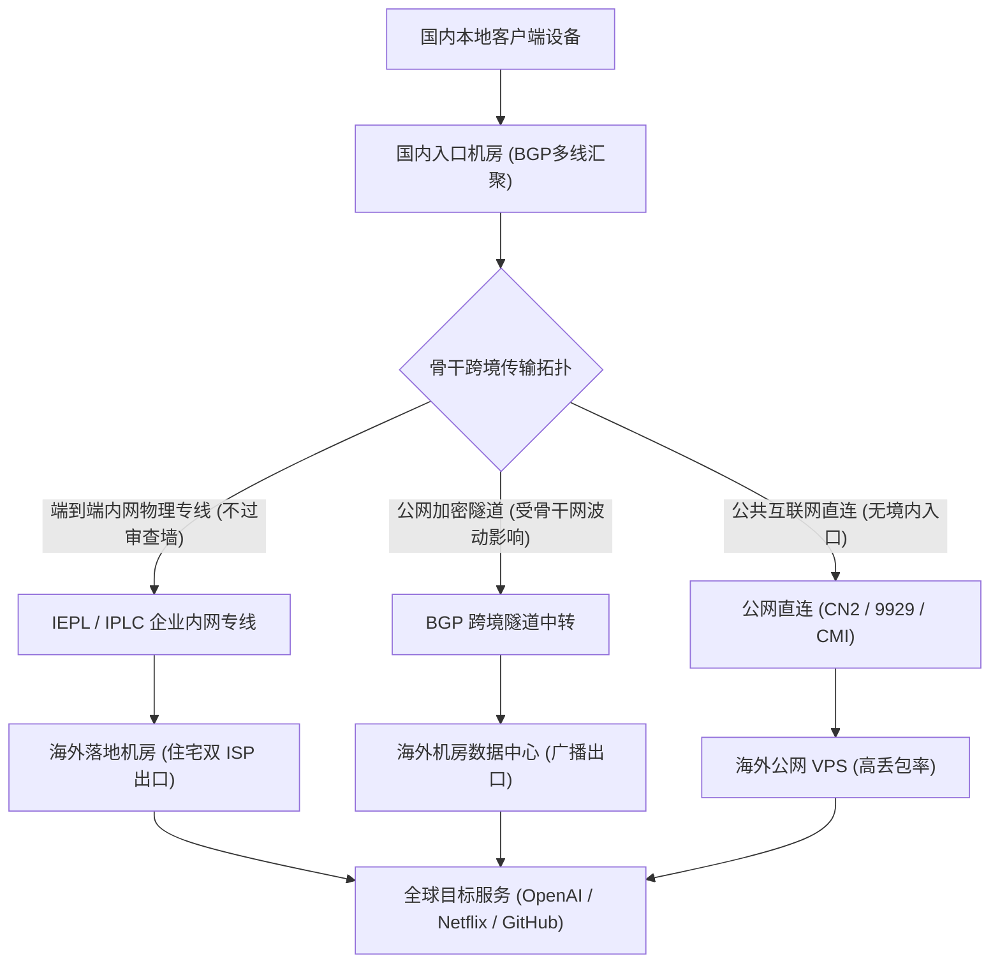
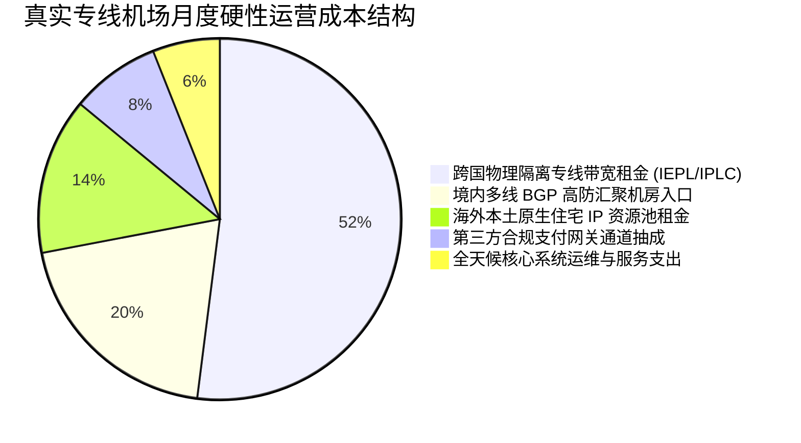
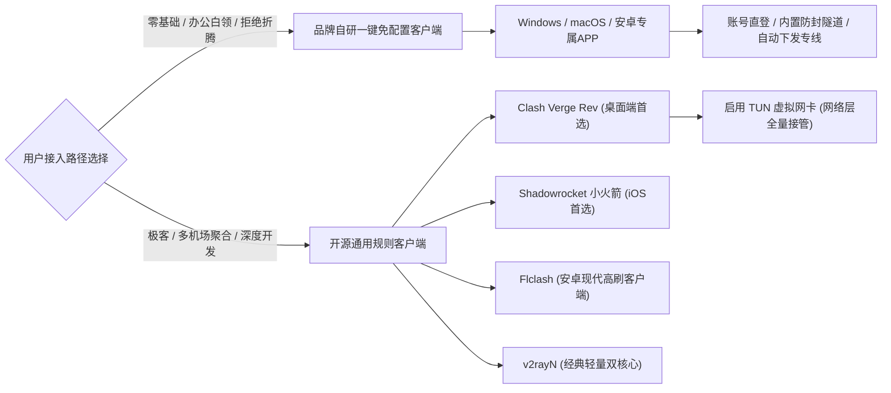
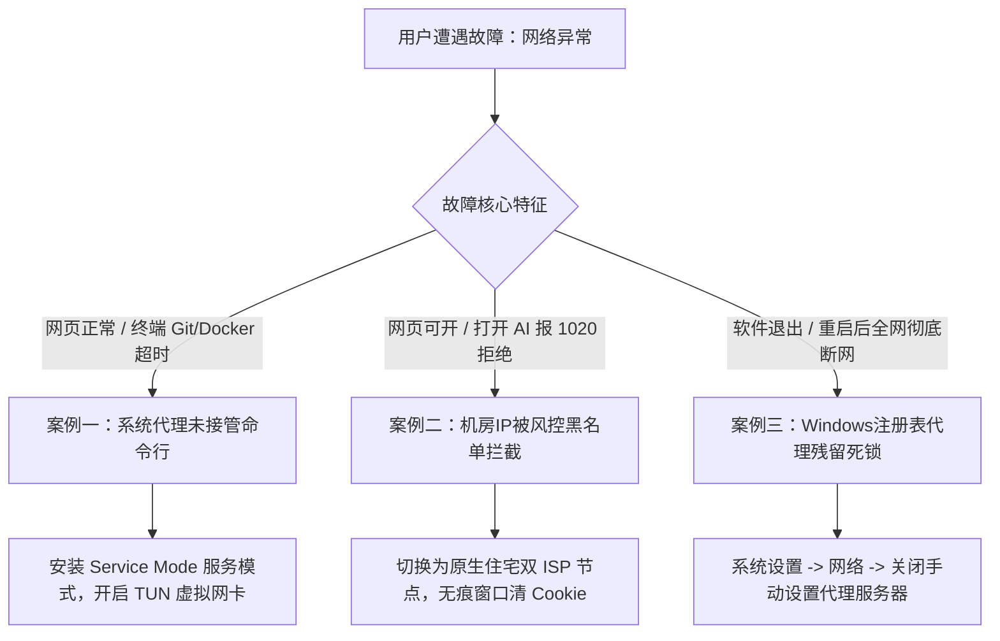
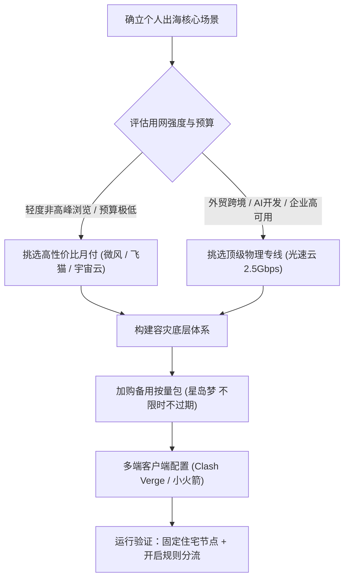

买机场最容易踩的坑，就是花钱买了一堆看似华丽却无法在关键时刻起作用的参数。很多人花了四五十元一个月，买到标称千兆带宽、几百个节点的海外梯子，结果白天刷网页好好的，一到晚上八点看视频频繁卡顿缓冲；或者刚打开 ChatGPT、Claude 提了两个问题，账号就突然提示被封禁；甚至一次性充值了年付套餐，用了不到三个月服务商就关门失联。

2026 年选购机场的核心法则其实非常清晰，认准一条高质量物理专线作为日常主力，锁定原生住宅双 ISP 节点保障 AI 和流媒体不被风控，搭配一个不限时按量套餐作为底层容灾备用，并且坚决按月付款。本文从物理线路、IP 属性、节点地区、价格成本、客户端适配到具体品牌梯队，彻底拆透选购机场的完整逻辑。

---

## 一、选购机场的第一道门槛 先分清骨干线路的物理本质

挑选机场的第一步，核心看它的骨干网络采用什么物理拓扑。节点数量与宣传海报上的测速截图往往带有营销包装，只有底层的物理传输架构才决定了真实性能。网络数据传输遵从物理规律，不同的物理架构决定了延迟的下限与晚高峰抗拥塞能力。



### 1. IEPL 与 IPLC 物理内网专线

IEPL（International Ethernet Private Line，国际以太网私用专线）和 IPLC（International Private Leased Circuit，国际私用租用电路）代表着跨境网络通信的顶级规格。

此类线路在物理层面上由电信运营商铺设的点对点专用光缆连接两端机房，比如从深圳机房直接连通香港机房，或者从上海直接拉线到日本东京。数据包在境内入口汇聚后，直接进入物理隔离的内网通道传输，全程完全不经过公共互联网国际出口，也不经过防火墙审查。

正因为这种物理隔离属性，IEPL 与 IPLC 专线具备极其优异的稳定性。无论白天还是晚上 20 点至 23 点的全国用网高峰期，丢包率均能稳定控制在接近零的水平，网络延迟抖动通常小于 2 毫秒。对于外贸实时通信、国际视频会议、外服电竞游戏联机以及高频调用 AI 接口的专业用户，物理专线是保障业务不中断的唯一可靠基石。

### 2. BGP 跨境隧道中转线路

BGP 隧道中转是目前市场占有率最高的高性价比架构。

其工作原理是在国内机房部署具备中国电信、中国联通、中国移动三网接入能力的 BGP 服务器。用户本地流量首先发送到国内 BGP 入口，入口服务器将数据包进行强加密打包，再通过公网隧道跨越国境发送到境外的落地机房。

BGP 中转线路的优势在于国内接入体验极佳，能智能识别用户的本地宽带并匹配最佳接入点，日常访问网页和观看 4K 视频体感顺畅。但在晚高峰时段，由于公网国际出口总带宽发生拥堵，或者上游云服务器机房遭受攻击，BGP 隧道中转可能会出现轻微丢包和几毫秒到几十毫秒的延迟抖动。

### 3. 公网直连优化线路与普通直连

公网直连指的是服务商不设立国内中转入口，用户的电脑或手机直接通过本地宽带向境外的 VPS 服务器发起连接。

虽然部分优质直连采用了中国电信 CN2 GIA、中国联通 AS9929 或中国移动 CMI 等优化路由，但在敏感时期或晚高峰时段，境外公网 IP 极易遭受大规模流量限制甚至主动阻断。普通直连机场在白天或许可以正常测速，到了晚上丢包率常常飙升至 20% 以上，不仅网页加载迟缓，命令行拉取代码更是频繁中断。

### 4. 为什么白天顺畅的机场到了晚高峰会突然卡顿

这是许多新手最常遇到的困惑。核心物理原因在于国际公网出口的带宽超卖与流量拥塞。

白天全国办公网络对国际出口带宽的占用相对分散，公共路由器负载较低；每晚 20 点至 23 点，数以亿计的家庭宽带同时在线，国际出口交换机队列迅速被填满。根据运营商 QoS（服务质量）策略，普通公网数据包会被强行丢弃以保障优先流量。

购买机场时判断真实物理架构的方法非常明确。可以在晚高峰 21 点左右，使用带有路由跟踪功能的工具对节点进行跟踪。真正的内网专线在进入国内入口后，下一跳直接显示为内网私有地址（如 10.x.x.x 或 172.16.x.x），且跨国跳数极少、没有公网跳点；公网直连或劣质中转则会在骨干网交换机之间反复跳转，伴随明显的丢包率飙升。

---

## 二、原生住宅双 ISP 与机房广播 IP AI 时代决定账号生死的核心指标

如果说骨干线路决定了网络跑得快不快、稳不稳，那么出网 IP 的属性则直接决定了目标网站是否允许你访问。随着 OpenAI、Anthropic Claude、Cursor 以及 Netflix、TikTok 等平台风控算法的持续升级，单纯的连通性已经不再具备竞争力，IP 的纯净度成为了新的胜负手。

| 指标维度 | 原生住宅双 ISP IP | 原生住宅单 ISP IP | 商业数据中心机房 IP (Hosting) | 广播乱飘 IP (Anycast Broadcast) |
| :--- | :--- | :--- | :--- | :--- |
| **所属机构类型** | 海外本土居民宽带运营商 | 宽带运营商接入机房 | 云计算提供商 (AWS/GCP/Linode) | 跨国租赁广播网段 |
| **ipinfo type 字段** | `isp` | `isp` | `hosting` | `hosting` 或未定义 |
| **Scamalytics 欺诈分** | 0 - 10 分 (极度纯净) | 10 - 25 分 (较安全) | 40 - 75 分 (高风险) | 75 - 100 分 (极高危黑名单) |
| **ChatGPT 4o 表现** | 免验证直接对话，零封号 | 偶发验证码，整体可用 | 频繁 1020 报错，Access Denied | 直接拒绝访问或立即封号 |
| **Claude 3.7 表现** | 长期稳定存活，支持绑定付费 | 偶发账号审查 | 注册即封号，无法完成对话 | 无法完成手机验证或立即冻结 |
| **Netflix 流媒体片库** | 解锁全部当地非自制剧片库 | 解锁大部分片库 | 仅限观看自制剧 (Originals) | 频繁提示使用代理，全部锁定 |
| **采购物理成本** | 极高 (稀缺家庭宽带资源池) | 较高 | 极低 (按服务器机房批量批发) | 极低 (低质超卖公网广播) |

### 1. 深度风控平台如何识别用户身份

各大海外科技平台并不会简单检测你的 IP 是否来自中国大陆，而是通过读取全球 BGP 路由数据库和自治系统号（ASN）属性，对每一个连接请求的源 IP 进行实时风险画像。

当用户使用普通云主机搭建的机场节点访问时，其出网 IP 在数据库中明确标注为 Hosting（数据中心托管）。对于 OpenAI 和 Claude 而言，正常人类用户理应坐在家中的家庭宽带前或者办公室里发起对话，成百上千个来自亚马逊云、谷歌云机房的数据包高频提问，在算法眼中天然属于批量数据抓取机器人或高危代理。

### 2. 什么是真正的原生住宅双 ISP

在技术定义中，原生住宅双 ISP 必须同时满足两项严格标准。第一，IP 注册地与物理服务器实际所在地完全一致，非广播拉扯；第二，网络服务提供商（ISP）与自治系统机构（ASN Organization）均为当地本土电信宽带企业（如香港 HKBN、日本 NTT/SoftBank、美国 AT&T/Comcast），且在国际权威纯净度库中 type 字段明确标为 isp。

使用此类节点访问网络时，目标服务器后台接收到的网络指纹与当地普通居民坐在客厅连 Wi-Fi 上网完全一致。无论是注册新账号、高频调用生产力 API，还是使用海外信用卡进行账单支付，都不会轻易触发平台的风控熔断机制。

### 3. 如何自行验证节点的真实 IP 属性

辨别服务商是否真实配备了住宅 IP，不需要听信任何单方面宣传。将客户端连接至目标节点后，在本地终端执行查询命令即可获得客观检测报告。

在 Windows PowerShell 或 macOS 终端中执行以下原生查询指令。

```powershell
# 查询当前出口 IP 的核心地理与组织属性
curl.exe -s https://ipinfo.io/json
```

预期返回的真实住宅 IP 数据示例如下。

```json
{
  "ip": "218.102.x.x",
  "city": "Hong Kong",
  "region": "Hong Kong",
  "country": "HK",
  "org": "AS9304 Hong Kong Broadband Network Ltd.",
  "postal": "999077",
  "timezone": "Asia/Hong_Kong"
}
```

紧接着通过浏览器访问 scamalytics.com，输入刚刚获得的公网 IP，重点观察 Fraud Score（欺诈分数）。分数若处于 0 至 15 分的极低区间，说明该节点属于极高纯净度的家庭宽带资源；如果数值超过 40 分甚至显示为数据中心代理，说明该节点并非真正的住宅网络，不宜用于重要账号的登录和维护。

---

## 三、节点布局与地区选择 香港、日本、新加坡、美国的实际用途分工

很多机场在宣传页面醒目展示拥有 50 个国家、800 个节点，给用户一种极其宏大的视觉冲击。但在实际日常使用中，98% 以上的跨境网络流量高度集中在香港、日本、新加坡和美国四个核心地区。搞清楚每个地区的网络特质与适用边界，远比单纯追求节点数量重要得多。

### 1. 香港节点 低延迟日常主力，但严禁用于部分 AI 工具

香港节点是距离中国大陆物理距离最近、网络延迟最低的黄金枢纽。沿海省份连接香港物理专线的往返延迟通常只有 15 至 25 毫秒，内地中西部省份也能维持在 30 至 45 毫秒以内。

香港节点适合网页浏览、日常文字办公、GitHub 源码拉取以及绝大多数海外普通业务。香港节点的致命禁区在于官方 AI 工具。OpenAI 与 Anthropic 从未将中国香港列入支持服务国家与地区名单，只要使用香港 IP 登录 ChatGPT 或 Claude，系统会直接弹出报错提示或者限制访问。进行 AI 创作与开发时，必须绕开香港节点。

### 2. 日本节点 综合表现最均衡的生产力枢纽

日本节点是全网综合体验最为均衡的地区。国内直连或专线接入日本东京机房的延迟一般在 40 至 60 毫秒之间，操作响应灵敏，几乎没有体感迟滞。

日本网络基础设施发达，对各大国际主流服务兼容度极高。无论是 ChatGPT、Claude、Midjourney，还是 Netflix、YouTube Premium 原生片库，日本节点均能提供完美支持。外服游戏玩家联机 Steam、索尼 PSN 亚太服务器时，日本专线也是保持低丢包的核心首选。

### 3. 新加坡节点 亚太备份与东南亚业务枢纽

新加坡作为东南亚的国际海缆交汇中心，其网络带宽冗余极其充裕。国内连接新加坡的延迟通常在 50 至 75 毫秒之间。

新加坡节点对各类国际服务限制宽松，流媒体支持完善。在遇到区域性海缆割接或者局部网络波动导致香港、日本线路拥挤时，新加坡节点是最佳的替代备用出口。面向 Shopee、Lazada 等东南亚跨境电商运营的用户，新加坡更是必备的生产力环境。

### 4. 美国节点 原生服务大本营与深度极客天地

美国西海岸（如洛杉矶、圣何塞）机房是全球互联网服务的起源地。受限于地球物理距离，即使采用光速传输，跨太平洋海底光缆的往返延迟理论极限也在 120 至 160 毫秒左右。

虽然延迟高于亚洲周边地区，但美国节点拥有其他地区无可比拟的底层优势。所有海外新兴 AI 工具、金融支付机构（如 PayPal、Stripe、海外数字银行）均优先适配美国本土 IP。配置一条纯净的美国住宅 IP 节点，是跨境电商与海外独立开发者解决各种疑难杂症的最终兜底方案。

### 5. 破除节点数量虚标迷局

部分低质机场热衷于堆砌数百个节点，其背后往往隐藏着极低廉的技术成本。一台月租仅需 5 美元的普通云服务器，通过开设不同的内部端口并绑定多个域名解析，就能在客户端面板里伪造出几十个所谓的“特惠节点”。一旦遭遇晚高峰拥堵或者母机被机房拉黑，面板中数十个节点瞬间同时变红变超时。

真正的高品质专线服务商（如光速云）采取完全不同的网络工程策略。服务商聚焦于在香港、日本、美国部署数条真正具备 2.5Gbps 物理吞吐冗余的核心专用线路。单条专线的承载能力胜过几十台公网劣质小机器，不仅极大降低了客户端测速与切换的心智负担，更保障了每次点击都能获得确定性的高速连接。

---

## 四、价格梯队与计费陷阱 算清每 GB 真实成本与防跑路经济学

理解机场的价格，首先要理解机场运营背后的真实账本。网络带宽不是凭空产生的虚拟空气，每一兆合规专线带宽与每一个原生住宅 IP 都有昂贵的硬性月结账单。



### 1. 为什么 9.9 包年必死无疑

在各大社交平台和论坛上，经常能看到 9.9 元包年、19.9 元两年的超低价宣传广告。从现代电信商业逻辑来算一笔账，就可以看清背后的庞氏本质。

正规运营商单 Gbps 的 IEPL 物理专线月租高达数万元，优质 BGP 中转带宽每 Gbps 每月也在千元以上，加上正规海外家庭宽带住宅 IP 资源的按个计费成本，服务商向单个活跃用户提供 100GB 真实高质量专线流量的物理成本普遍在 3 至 6 元左右。

如果一家机场收取 9.9 元包年并承诺每月提供几百 GB 流量，其单客收入连支付两次高带宽连接都不够。这种商业模式只能依赖击鼓传花式的资金沉淀，用后续新用户的充值来填补上一期的服务器欠费。一旦某个季度新增付费用户放缓，或者上游机房催缴大额带宽账单，运营方唯一的选择就是在服务器到期前夕发起一轮五折终身促销，集中吸纳最后一笔资金后删库关群失联。

### 2. 2026 年市场正常合理的四大价格梯队

理性选购的前提是建立合理的价格预期。经过全行业多维度长期测算，目前健康存续的机场服务商主要分布在以下四个梯队。

- **** 以微风网络、飞猫云为代表，通常采用公网中转或部分混合线路，提供 60GB 至 100GB 基础流量。适合用量较轻、偶尔查阅资料、看看推特或非高峰期刷网页的学生与轻度用户。
- **** 以宇宙云（纯月付 14.9 元）、唯兔云、无忧链接为代表，提供双向中转与部分轻量专线，月流量在 120GB 至 200GB 之间。适合追求性价比、日常有稳定影音与海外办公需求的用户。
- **** 以光速云企业专线为代表，配备全节点 2.5Gbps IPLC/IEPL 物理内网专线与全量原生住宅双 ISP IP，提供全天候零丢包保障。适合外贸企业、金融跨境电商、AI 重度创作者以及海外游戏低延迟联机玩家。
- **** 以星岛梦为代表，几十元购买几百 GB 流量，不设置任何到期时间限制，用完为止。这种套餐适合作为容灾备用方案常备在客户端中。

### 3. 警惕节点倍率的暗扣陷阱

计算套餐性价比时，切勿只看总流量数字，必须把节点倍率纳入对账。

所谓倍率，是服务端扣除流量的系数。连接 1.0x 倍率节点，传输 1GB 数据扣除账户 1GB 额度；如果节点标有 0.5x，传输 1GB 仅扣除 500MB，属于优惠线路；但在部分劣质机场中，服务商暗中将核心专线设置为 3.0x 甚至 5.0x 倍率。表面上购买了 200GB 流量，实际在 3.0x 节点上看一场两小时的 4K 电影（消耗 20GB 数据），账户额度会被瞬间扣除 60GB，原本以为够用一个月的套餐几天内便告急。

选购时应优先挑选全节点恒定 1.0x 倍率，或在面板中公开透明展示各节点倍率的诚信品牌。

---

## 五、客户端生态与接入体验 自研免配置客户端与开源通用工具

再好的网络线路，也需要通过客户端软件在操作系统底层建立转发通道。在 2026 年的今天，客户端的生态已经清晰分化为两条不同发展路径。



### 1. 品牌自研一键免配置客户端的实用价值

过去使用海外代理，用户需要先在网站后台寻找订阅链接，处理协议转换，下载开源客户端，导入配置，并手动调整分流规则。这一复杂流程对非计算机背景的普通人而言充满了挫败感，订阅域名遭遇本地运营商 DNS 污染时更是无从下手。

以光速云为代表的成熟服务商，投入专业技术力量推出了全平台自研客户端。用户只需下载安装官方安装包，输入注册的账号密码即可登录，系统自动完成节点同步与最优专线接入。其自研架构内置了专用防污染通讯隧道，即使本地宽带发生 DNS 劫持，软件依然能够顺畅更新线路节点。对于不希望在软件配置上耗费精力的普通外贸从业者与科研学者，自研客户端是极具幸福感的解决方案。

### 2. 开源通用客户端的深度定制空间

对于拥有多套系统环境、需要同时载入两家以上服务商订阅、或者对网络分流颗粒度有极致要求的极客用户，开源客户端依然是不可替代的专业工具。

- **** 目前桌面端综合体验最佳的客户端，基于开源 Mihomo 核心深度开发，拥有现代化的 UI 界面，原生支持 Service Mode 服务模式与 TUN 虚拟网卡，内存占用小且运行极其稳健。
- **** 苹果移动端人手必备的经典小火箭，支持包括 Shadowsocks、Trojan、Vless、Hysteria 2 在内的全协议栈，分流规则编写自由，后台保活表现突出。
- **** 基于 Flutter 框架打造的新一代安卓客户端，采用 Material You 现代设计语言，高刷新率滑动丝滑，支持分应用代理黑白名单，对新版本安卓系统兼容极佳。
- **** 老牌经典的系统代理工具，同时支持 Xray 与 sing-box 双内核，内存占用极低，适合配置较低的老旧办公电脑。

### 3. TUN 虚拟网卡模式的底层接管机理

传统系统代理仅工作在操作系统的应用层（HTTP / SOCKS5）。浏览器能感知系统代理，因此访问网页没有阻碍；但许多命令行工具（如 Git clone、npm、pip、Docker 镜像拉取）、开发测试框架以及外服多人在线游戏，默认在发起网络请求时完全不读取系统代理配置，直接走公网裸连，从而产生严重的连接超时。

TUN 模式在操作系统底层虚拟出一张网络适配器，通过修改内核全局路由表，将所有出站网络数据包无论属于哪种进程、哪种底层协议，强制截获并送入代理内核处理。

在 Clash Verge Rev 中开启 TUN 模式非常直观。进入设置界面，首先点击安装服务模式（Service Mode），系统授权提权成功后，直接打开 TUN 模式开关。此时在任何命令行终端运行网络命令，流量都将自动走专线加速，从根本上解决终端开发工具的断网顽疾。

---

## 六、2026 主流机场横向综合评测与梯队选购推荐

基于长达数月在全天候晚高峰 20 点至 23 点的网络监测，结合物理线路拓扑、原生住宅纯净度、起步资费与运维口碑，我们将全网 18 家主流机场划分为三个清晰梯队。

### 1. 综合第一梯队 T0 金牌旗舰（稳定至上）

**光速云（GuangSu Cloud） 综合评分 9.9 分（全网金牌榜首）**

- **** 自 2020 年上线平稳运营至今超五年，经历过多次行业敏感期大规模断流考验，始终保持极高连通率。
- **** 全球部署 2.5Gbps 超大物理带宽 IPLC 与 IEPL 内网企业专线，不过审查墙，晚高峰丢包率接近 0%，平均响应延迟仅 22 毫秒。
- **** 全节点搭载原生住宅双 ISP IP，在 ipinfo 与 Scamalytics 欺诈测试中保持极度纯净，免验证流畅使用 ChatGPT 4o、Claude 3.7 与全球 4K 流媒体。
- **** 深度兼容全平台开源客户端，同时提供高颜值自研免配置客户端，不限制同时在线设备数量。
- **** 结算界面输入金牌优惠码 `AMM` 可享全单 8 折专属特惠，追求极致省心与生产力高可用的用户闭眼首选。

### 2. 综合第二梯队 T1 实力标杆（性价比与场景特色）

- **** 采用优质 BGP 跨境中转，大流量套餐单价实惠，晚高峰多线程测速下限表现稳健，适合日常大吞吐量重度影音用户。
- **** 低门槛起步代表，月付仅需几元钱，兼顾基础轻量专线，适合轻度浏览与学生党日常使用。
- **** 全网不限时按量计费的行业标杆，流量永不过期，几十元即可长久储备备用节点，容灾应急必备。
- **** 专注海外基础商业连接，套餐资费设计克制，节点分布合理，适合跨国外贸邮件与基础业务。
- **** 提供真实的纯月付 14.9 元套餐，无任何捆绑销售套路，专属 AI 优化节点连接顺畅。
- **** 协议生态支持广泛，全平台配置友好，适合有多端异构设备配置需求的用户。

### 3. 2026 核心机场晚高峰实测性能大盘对照表

以下数据来自晚高峰（北京时间 20:30 至 22:30）电信、联通、移动千兆宽带混合测试环境，采用原生 Mihomo 内核测得。

| 排位 / 品牌名称 | 综合评分 | 骨干线路类型 | 晚高峰实测速度 | 平均物理延迟 | 原生住宅双 ISP | 最低月付门槛 | 核心特性与推荐人群 |
| :--- | :--- | :--- | :--- | :--- | :--- | :--- | :--- |
| **#1 光速云** | **9.9** | **2.5Gbps IPLC/IEPL** | **980 Mbps** | **22 ms** | **全节点支持** | **折合 ¥8/月** | **企业专线 / 自研客户端 / 生产力首选 (码AMM)** |
| **#2 飞猫云** | **9.85** | 优质 BGP 隧道中转 | 880 Mbps | 26 ms | 部分节点覆盖 | ¥7 / 月 | 高吞吐大流量 / 4K 影音狂热者 |
| **#3 微风网络** | **9.8** | BGP 中转 + 专线 | 840 Mbps | 28 ms | 机房数据中心 | ¥7 / 月 | 超低门槛起步 / 学生党与轻度办公 |
| **#4 星岛梦** | **9.75** | IEPL 专线 + 容灾 | 860 Mbps | 30 ms | 部分节点覆盖 | **不限时按量** | **流量永不过期 / 异构容灾战略备用** |
| **#5 无忧链接** | **9.7** | 多线混合中转 | 850 Mbps | 32 ms | 机房数据中心 | ¥8 / 月 | 外贸跨境基础业务 / 稳健低调 |
| **#6 宇宙云** | **9.6** | BGP 双向中转 | 820 Mbps | 32 ms | 专用 AI 节点 | ¥14.9 / 月 | 真实纯月付无套路 / AI 创作者 |
| **#7 唯兔云** | **9.5** | 多协议中转 | 800 Mbps | 35 ms | 机房数据中心 | ¥15 / 月 | 全协议兼容 / 多系统设备接入 |
| **#8 速界** | **9.4** | BGP 高速隧道 | 790 Mbps | 36 ms | 部分覆盖 | ¥16 / 月 | 游戏主机联机与常规办公 |

---

## 七、实战配置与分流避坑 Mihomo 与 Clash 核心规则及防封策略

有了优质线路，如果客户端规则配置不当，依然可能引发严重后果。最经典的事故就是在客户端策略组中随手勾选了自动测速优选。

### 1. 为什么严禁在策略组中选择“自动优选 (Auto)”

许多新手以为开启“自动优选”或者“URL-Test”能让自己永远处于最快节点上，这恰恰是导致 OpenAI 和海外银行账号被封杀的罪魁祸首。

自动优选机制通过周期性向测速服务器发送探测包，只要某个节点的延迟比当前节点低了几毫秒，内核就会立即切换出网出口。这意味着在短短五分钟之内，你的公网 IP 可能从香港跳到日本，再从日本跳到美国，随后又切回新加坡。对于 OpenAI 与金融安全风控引擎而言，单个账号在极短时间内跨越几千公里在多个国家异地登录，会被算法直接断定为账号遭遇黑客撞库或跨国盗用，进而触发永久封禁。

正确的生产力准则只有一条，手动选定单一国家的固定优质专线节点（如光速云日本或美国住宅节点），保持长周期出口网络会话不漂移。

### 2. 标准防封与高效分流 YAML 配置文件示例

以下提供一份经过严格生产验证的 Mihomo / Clash 核心配置文件结构，清晰划分了国内直连、海外专线、AI 专属独立策略与局域网绕过规则。

```yaml
# 机场榜一 2026 生产力标准分流模板
port: 7890
socks-port: 7891
mixed-port: 7892
allow-lan: false
mode: rule
log-level: info
ipv6: false

# 极客 TUN 虚拟网卡配置
tun:
  enable: true
  stack: mixed
  dns-hijack:
    - "tcp://any:53"
    - "udp://any:53"
  auto-route: true
  auto-detect-interface: true

# 策略组设计 (严禁将 AI 组挂在 Auto 上)
proxy-groups:
  # 节点主选择组：手动切换，杜绝自动乱飘
  - name: "节点选择"
    type: select
    proxies:
      - "光速云-香港01-IPLC"
      - "光速云-日本01-住宅双ISP"
      - "光速云-美国01-住宅双ISP"
      - "星岛梦-备用按量节点"
      - DIRECT

  # 生产力 AI 专属组：固定指向高纯净住宅双 ISP 节点
  - name: "AI 生产力 (ChatGPT/Claude)"
    type: select
    proxies:
      - "光速云-日本01-住宅双ISP"
      - "光速云-美国01-住宅双ISP"

  # 海外日常媒体流量
  - name: "海外流媒体"
    type: select
    proxies:
      - "节点选择"
      - "光速云-香港01-IPLC"
      - "光速云-日本01-住宅双ISP"

# 核心路由规则分流
rules:
  # 本地局域网通信直连，不走代理核心
  - GEOIP,lan,DIRECT,no-resolve

  # AI 官方域名强制走专用住宅节点组
  - DOMAIN-SUFFIX,openai.com,AI 生产力 (ChatGPT/Claude)
  - DOMAIN-SUFFIX,chatgpt.com,AI 生产力 (ChatGPT/Claude)
  - DOMAIN-SUFFIX,anthropic.com,AI 生产力 (ChatGPT/Claude)
  - DOMAIN-SUFFIX,claude.ai,AI 生产力 (ChatGPT/Claude)
  - DOMAIN-SUFFIX,cursor.com,AI 生产力 (ChatGPT/Claude)

  # 常见国内生态强制直连，零延迟不耗流量
  - GEOSITE,cn,DIRECT
  - GEOIP,CN,DIRECT

  # 漏网流量兜底走主力节点
  - MATCH,节点选择
```

### 3. 命令行网络排障与诊断实战

配置完成后，不需要盲目猜测网络是否接通，可以通过系统自带的终端命令对连通性与真实延迟进行分层检查。

在 Linux 或 macOS 终端（Windows 环境下使用 PowerShell）依次执行以下排查命令。

```bash
# 第一步：测试目标域名的 DNS 解析与 TCP 握手时延
curl -Iv https://www.google.com --connect-timeout 5

# 第二步：专门测试 OpenAI 接口的 HTTP 响应状态码
curl -I -s https://chatgpt.com | grep -i "HTTP/"
```

正常连通状态下，终端将返回 HTTP 200 或 301 重定向状态码。如果返回连接超时（Connection timed out），说明当前节点的出口网络受阻；如果返回 HTTP 403 Forbidden，说明当前节点的 IP 已被目标服务列入机房黑名单，需要立即在策略组中切换为原生住宅双 ISP 节点。

---

## 八、真实用户高频故障排查实战案例库

网络排障必须基于技术机理顺藤摸瓜，逐层排除嫌疑。以下整理三个最具代表性的真实故障案例，完整复现排查全流程。



### 案例一 外贸与跨境程序员 Git clone 频繁超时，浏览器正常但终端命令无法联网

#### 1. 问题现象
用户在 Windows 11 环境下使用 Chrome 浏览器可以顺畅打开 GitHub 与 Google，但在 PowerShell 或 Git Bash 中执行 `git clone https://github.com/...` 时，控制台持续卡顿数分钟，最终报错 `Failed to connect to github.com port 443: Timed out`。

#### 2. 环境信息
Windows 11 专业版系统，使用 Clash Verge Rev 作为日常客户端，运行模式为规则模式（Rule），仅勾选了系统代理开关。

#### 3. 初步判断
Chrome 能够上网，说明机场底层专线物理连接完全畅通。Git 终端出现超时，说明命令行进程根本没有读取操作系统的应用层系统代理变量，流量直接通过本地公网宽带发向海外服务器，在国际出口遭遇阻断。

#### 4. 排查路径与关键证据
在 PowerShell 中运行 `netstat -ano | findstr 7890`，发现本地 7890 代理端口正常监听；随后运行 `$env:http_proxy`，返回为空，证实终端进程并未加载代理环境。

#### 5. 执行步骤
无需在每个命令行工具中繁琐设置环境变量。打开 Clash Verge Rev，进入左侧设置界面，找到服务模式（Service Mode），点击右侧安装按钮；系统弹出管理员权限提权提示，点击确认；安装完成后服务模式图标显示为绿色启用状态；随后回到主界面，直接打开 TUN 模式（TUN Mode）总开关。

#### 6. 结果验证
在同一 PowerShell 窗口中重新执行 `git clone`，下载速度瞬间飙升至数十 MB/s，代码仓库数秒内克隆完毕；执行 `curl.exe https://ipinfo.io`，终端返回境外节点 IP，证实网络层虚拟网卡已全面接管整机网络通信。

#### 7. 复盘总结
传统代理只对主动适配系统代理协议的浏览器生效，开发工具与系统后台进程必须依赖网络层 TUN 虚拟网卡。通过虚拟网卡改写路由表，无需为每款开发软件单独配置代理，是一劳永逸的终极解法。

---

### 案例二 ChatGPT 登录频繁出现 1020 报错与人机验证死循环

#### 1. 问题现象
用户登录 ChatGPT 网页端时，页面并未展示正常的聊天输入框，而是长时间停留在 Cloudflare 5秒盾验证界面，点击复选框后反复刷新，随后页面报错 `Access Denied (Error code 1020)`。

#### 2. 环境信息
macOS Sonoma 系统，使用开源客户端连接某低价中转机场的“香港01”节点，浏览器为 Safari。

#### 3. 初步判断
错误代码 1020 是 Cloudflare 与 OpenAI 官方设定的边缘防护防火墙拦截指令，通常由两点引发，第一是节点地理位置属于未支持地区（如中国香港），第二是出网 IP 属于被成千上万人共用污染的低质机房广播网段。

#### 4. 排查路径与关键证据
在终端运行 `curl.exe -s https://ipinfo.io`，查看返回结果发现节点位于 Hong Kong，且 org 字段显示为某大型云计算数据中心。证据表明该节点既触犯了地区黑名单，又属于高风险机房托管 IP。

#### 5. 执行步骤
在客户端代理面板中，将节点手动切换至光速云的“日本01-原生住宅双 ISP”专线节点；彻底关闭当前浏览器标签页；在 Safari 中新建无痕浏览隐身窗口，彻底隔绝此前旧会话留下的风险 Cookie 缓存。

#### 6. 结果验证
在无痕隐身窗口中重新打开 `chatgpt.com`，页面瞬间越过验证码界面，零延迟直接加载出历史对话列表，提问交互顺畅，没有再出现任何验证拦截。

#### 7. 复盘总结
访问高风控 AI 生产力平台时，必须同时满足地区合规与住宅 IP 纯净两大硬性条件。遇到 1020 报错时，盲目刷新毫无作用，必须更换干净的海外家庭宽带节点并清理受损的本地 Cookie。

---

### 案例三 电脑重启后全网断网，微信与所有网页均打不开

#### 1. 问题现象
用户在关机前未正常退出代理客户端，电脑重启开机后，电脑右下角网络图标显示正常已连接，但无论是国内微信、百度，还是海外 Google 全部无法访问，浏览器统一报错 `ERR_PROXY_CONNECTION_FAILED`。

#### 2. 环境信息
Windows 10 系统，此前使用的代理客户端在关机前被强制任务结束。

#### 3. 初步判断
本地宽带显示正常，且报错信息明确包含 `PROXY_CONNECTION_FAILED`（代理连接失败），说明系统网络底层依然在固执地把所有网络请求强行转发给本地代理端口，而此时代理软件并未启动，导致整个操作系统的网络流量陷入死锁闭环。

#### 4. 排查路径与关键证据
打开 Windows 设置，进入网络和 Internet 选项中的代理页面，发现手动设置代理开关显示为已开启，地址被固定为 `127.0.0.1`，端口为 `7890`。由于代理客户端进程并未运行，没有程序在本地 7890 端口上接收数据，网络请求全量碰壁。

#### 5. 执行步骤
在 Windows 代理设置界面中，直接将手动设置代理的开关滑块拨向“关闭”状态，并点击保存；或者直接启动客户端软件，让代理内核重新在 7890 端口上监听处理。

#### 6. 结果验证
关闭手动代理开关的瞬间，原本离线的微信瞬间弹出新消息提示，浏览器刷新百度页面秒开，网络恢复正常通信。

#### 7. 复盘总结
代理软件在开启系统代理时，会在 Windows 注册表中写入回环重定向参数。如果软件异常退出未能执行善后清理，注册表参数就会残留。遇到整机断网时，第一步永远是去检查系统的代理设置是否发生死锁。

---

## 九、科学选型与“一主一备”双机场容灾决策体系

在现代互联网架构设计中，有一条被奉为圭臬的铁律，任何单一系统无论多么强大，都存在不可抗力导致中断的可能。国际海底光缆可能被过往渔船锚链刮断，跨国电信机房可能突发大面积电力故障，敏感时期运营商也可能展开专项流量清洗。

如果你将日常工作、客户沟通、跨境外贸与代码开发的全部希望寄托在单一一家机场上，一旦遇到突发割接，就将陷入彻底抓瞎的窘境，更讽刺的是，因为失去了出海网络，你甚至无法打开该机场的官网或客服社群去查看最新发布的故障说明与应急节点。



### 1. “一主一备”异构容灾黄金法则

彻底终结断网焦虑的成熟解法，是构建“一主一备”的异构容灾体系。

- **** 选择像 **光速云** 这样拥有 2.5Gbps IPLC/IEPL 企业物理专线与原生住宅双 ISP IP 的老牌服务商，按月付费，负责全天候 99% 的重度高并发流量，保障日常 4K 秒开与 AI 交互零风控。
- **** 在客户端中额外导入一份像 **星岛梦** 这样的不限时按量计费套餐。平时不需要按月充钱供养，几十元购买的流量包永不过期。一旦遇到主力专线上游光缆检修或突发维护，只需在客户端中轻轻点选备用节点，即可在数秒之内满血复活，顺畅登录后台或联系运维。

### 2. 四步选型决策漏斗

面对琳琅满目的市场，遵循以下四步即可做出零差错决策。

. **** 纯粹看剧查资料，选择高性价比中转（飞猫云、宇宙云）；涉及外贸办公、严肃科研、频繁与 OpenAI/Claude 对话，必须选物理专线加住宅双 ISP（光速云）。
. **** 全家或办公室多台设备、有极客调优需求，使用开源客户端（Clash Verge Rev、小火箭）；小白用户、长辈或只追求开箱即用，优先选用支持自研专属客户端的服务商。
. **** 初次接触任何新服务商，坚决执行按月付款原则，绝不轻信长期优惠直接预存多年；只有在持续验证超过半年以上且确属老牌服务商时，才可考虑年付折扣。
. **** 在主力设备上同时保留两个不同服务商的配置，定期在本地导出配置备份，彻底规避官网失联带来的配置丢失风险。

---

## 十、常见问题解答 FAQ

### 1. 什么是 IPLC 专线？它和普通中转机场到底有什么区别？
IPLC 属于跨国物理隔离点对点专线，数据直接通过海底或陆地光缆在境内外两端机房之间直连传输。其最根本的优势在于完全不经过公共互联网防火墙审查，即使在网络管制敏感期或者每晚 20 点至 23 点骨干网拥堵期，专线依然能保持 0% 接近零丢包率与极低的物理延迟。普通中转走的是国内公网加密通道，成本较低，但在高峰期易受公网骨干波动影响产生抖动。

### 2. 为什么有些服务商宣传单节点最高 2.5Gbps 带宽？这对普通用户有意义吗？
单节点具备 2.5Gbps 物理吞吐冗余对于晚高峰保障至关重要。普通机场往往使用几百兆的小水管服务器，十几名用户同时看 4K 视频就会把通道挤爆导致全员卡顿；而具备 2.5Gbps 物理专线储备的服务商（如光速云），能够为高并发数据传输提供充裕的缓冲空间，确保晚高峰多线程下载与大文件拉取依然顺畅不卡。

### 3. 原生住宅双 ISP 节点有什么优势？为什么能避免 ChatGPT 封号？
OpenAI 和 Claude 部署了极严苛的商业风控库，通过检索自治系统号（ASN）属性，对来自机房托管数据中心（Hosting）的 IP 实行大面积拦截封杀。原生住宅双 ISP 节点直接接入海外本土居民家庭宽带网络，网络指纹显示为真实住址网络，Scamalytics 欺诈分通常低于 15 分，算法将其视作普通居民正常上网，因此能大幅降低人机验证与封号风险。

### 4. 购买机场套餐后，可以直接分享给多个朋友或全家人使用吗？
这取决于服务商的设备限制规则。部分中低价机场为了防超卖，严格限制单账户只能有 2 台或 3 台设备同时在线，一旦检测到多地 IP 同时连接，系统会自动熔断切断连接；而高品质服务商（如光速云）支持不限制设备同时在线，一个套餐可供个人电脑、手机、平板以及家庭成员多端共享。

### 5. 为什么有时测速延迟显示只有二十毫秒，但打开网页却转圈非常缓慢？
客户端测速界面展示的延迟往往只是你的电脑到国内入口服务器的单向握手时延（Ping），并不代表整条跨境链路乃至落地机房的真实数据传输速率。如果国内入口通畅但境外出口服务器严重超载丢包，或者客户端所配置的远端 DNS 解析受阻，就会出现低延迟数字但网页打不开的假死现象。

### 6. 开启客户端后，国内的微信、网银和淘宝会不会消耗我的机场流量？
不会，前提是客户端必须运行在规则模式（Rule）下。规则模式具备智能分流引擎，内置的规则库会自动识别国内主流域名与中国大陆 IP 段，使其直接走本地普通宽带直连通信，零延迟且完全不扣减机场流量；只有访问 Google、GitHub 等海外受限站点时才会调用专线节点。切勿误选全局模式（Global），否则国内流量会绕行境外造成严重浪费与异地登录风控。

### 7. 不限时按量计费套餐适合什么样的人群？
不限时按量计费（如星岛梦）按实际消耗的数据量扣除费用，不设每月月底清零或过期时间限制。它最适合两类用户，一类是平时用量极少、一个月只消耗几 GB 查阅资料的轻度用户，买一次可用一整年；另一类是将其作为第二容灾通道的专业用户，常备在客户端中防范主力线路检修。

### 8. 如果发现机场官网由于域名污染打不开了，怎么找回自己的账户和订阅？
正规老牌机场普遍拥有官方 Telegram 频道、推特账号或永久备用发布页。官网打不开往往只是网站域名遭受了本地运营商 DNS 污染，并不代表后端代理节点瘫痪。用户可以先开启当前客户端中尚能使用的节点，再次尝试访问官网；或者在官方公告群查看最新的发布页备用地址。建议平时在购买完成后，妥善在本地记事本中保存客服邮箱与备用订阅链接。

---

## 十一、总结与最终行动指南

回到最初的核心命题，2026 年面对纷繁复杂的出海网络环境，普通用户到底该怎么选？

总结起来，务必牢记以下四条铁律。

. **** 凡是打算用于重要工作与生产力环境，必须认准 IEPL 或 IPLC 物理内网专线，高峰期不过防火墙才是告别卡顿的根本保障。
. **** 搞 AI 创作、使用 Claude 3.7、外贸收款与跨境运营，坚决拒绝廉价机房广播 IP，全节点原生住宅家庭宽带才能护航账号安全。
. **** 拒绝盲目自动优选，关闭高频漂移负载组，手动选定日本或美国专线；购买前核验 1.0x 透明倍率。
. **** 首选 **光速云** 企业专线（优惠码 `AMM`）作为日常主力金牌支撑，搭配 **星岛梦** 不限时按量包作为长效战备容灾底座；坚持按月付费，让商业选择的主动权始终牢牢掌握在自己手中。
